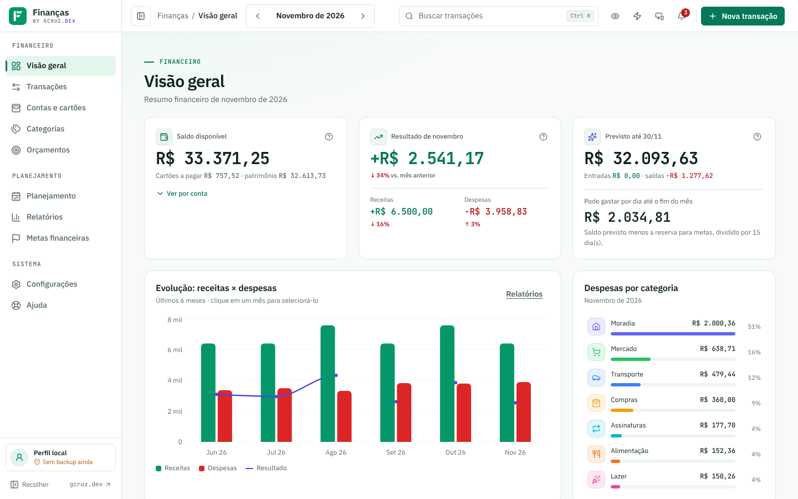
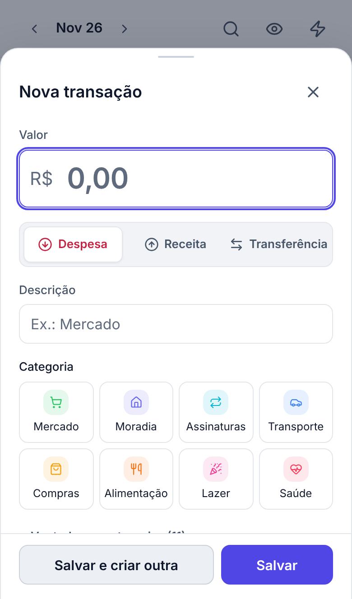
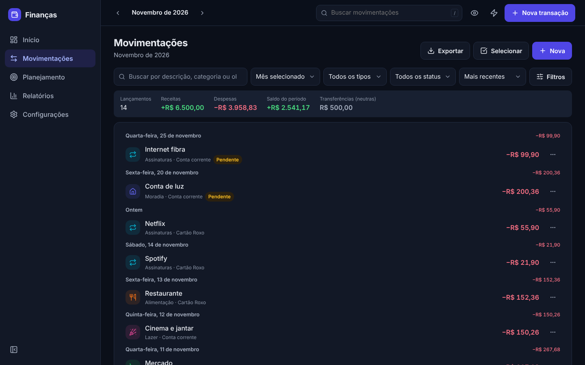
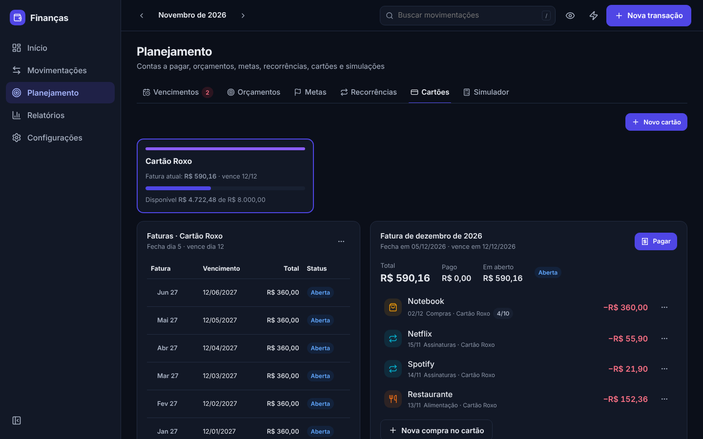
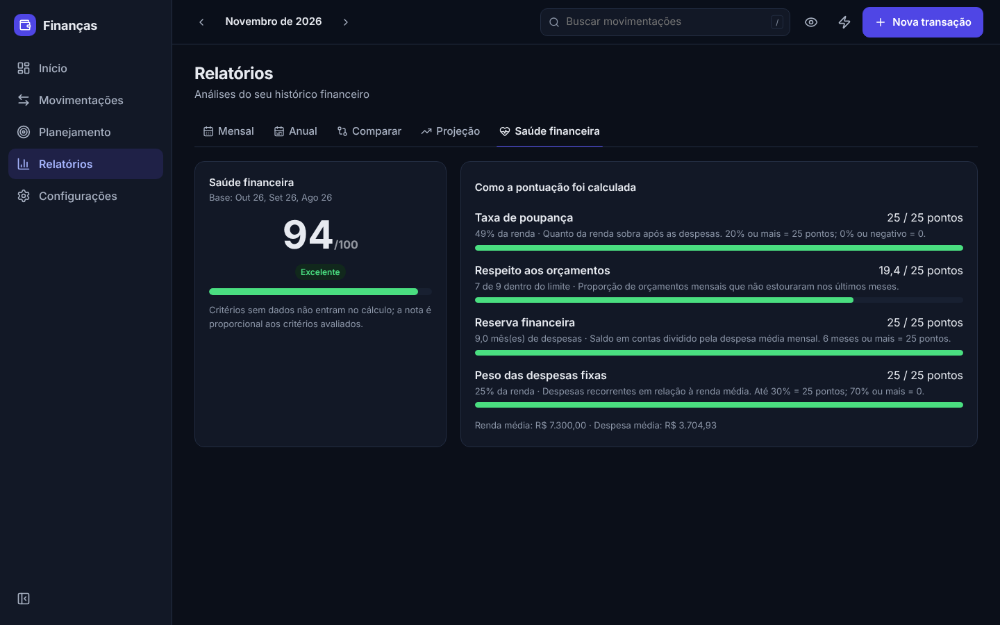

<p align="center"></p>

<h1 align="center">Finanças</h1>

<p align="center"><code>BY GCRUZ.DEV</code> · <b>Personal Finance Management Platform</b> · <i>Tenha clareza sobre seu dinheiro.</i></p>

<p align="center">
  Controle financeiro pessoal <b>local-first</b>: receitas, despesas, contas, cartões, parcelas, recorrências, orçamentos, metas, relatórios e projeções — no seu navegador, sem servidor.
</p>

<div align="center">

  [](https://financas.gcruz.dev.br)
  [](https://github.com/https-shini/financas-reactjs)
  [](./LICENSE)

</div>

<div align="center">
  
</div>

---

## Sumário

[Descrição](#descrição) · [Identidade visual](#identidade-visual-e-design-system) · [Funcionalidades](#funcionalidades) · [Tecnologias](#tecnologias) · [Requisitos](#requisitos) · [Instalação e execução](#instalação-e-execução) · [Testes](#testes) · [Build](#build) · [Deploy](#deploy-vercel) · [Estrutura](#estrutura-do-projeto) · [Seus dados: backup e segurança](#seus-dados-backup-e-segurança) · [Limitações conhecidas](#limitações-conhecidas)

## Descrição

O **Finanças** (by GCruz.DEV) é uma aplicação React para gestão financeira pessoal. Todos os números vêm dos seus lançamentos, com regras explícitas e testadas:

- valores guardados em **centavos inteiros** (sem erros de arredondamento de ponto flutuante);
- **transferências** movem dinheiro entre contas sem contar como receita ou despesa;
- lançamentos **pendentes** e futuros não entram no saldo realizado, mas entram nas projeções;
- o **pagamento de fatura** não duplica as compras já registradas no cartão;
- **recorrências** nunca geram lançamentos duplicados, mesmo abrindo o app várias vezes.

Os dados ficam **somente no seu navegador** (localStorage). Nada é enviado a servidores.

## Funcionalidades

**Visão geral (painel de controle)** — saldo atual (com detalhe por conta, dívida de cartões e saldo previsto no fim do mês), total a pagar e total a receber (com valores em atraso), resultado do mês comparado ao anterior, receitas × despesas dos últimos 6 meses com o resumo do mês, próximos vencimentos (a pagar e a receber), movimentações recentes, despesas por categoria, calendário do mês e um guia inicial para quem ainda não tem dados. Um único seletor de mês controla o painel.

**Contas a pagar** (`/contas-a-pagar`) — despesas pendentes, faturas de cartão em aberto e pagamentos de fatura agendados; indicadores (total a pagar, em atraso, vence em 7 dias, pago no mês); listas Em aberto (agrupada em Em atraso · Vence hoje · Próximos 7 dias · Mais adiante) e Pagas (por mês); busca e filtros por categoria, tipo (contas ou faturas) e horizonte; marcar como pago, reabrir, editar e pagar fatura; compromissos por categoria.

**Contas a receber** (`/contas-a-receber`) — receitas pendentes e recebidas, com indicadores próprios (total a receber, em atraso, previsto em 7 dias, recebido no mês), as mesmas listas e filtros por origem, marcar como recebido e reabrir; valores a receber por origem.

**Movimentações** — cadastro, edição, duplicação e exclusão com **desfazer**; busca por descrição, categoria ou observação; filtros por período, tipo, status, categoria e conta (refletidos na URL); ordenação; agrupamento por dia com subtotal; totais do filtro; seleção em lote (marcar como pago, recategorizar, excluir); exportação do filtro em CSV, Excel, PDF e Word.

**Cadastro** — painel (bottom sheet no celular) com valor em destaque e máscara `R$ 1.234,56`, tipo (despesa, receita, transferência), descrição, categorias em grade, data com atalhos Hoje/Ontem, conta ou cartão, status pago/pendente, observações, **repetir** (recorrência) e **parcelar**. Enter salva, Esc fecha, "Salvar e criar outra". Edição de lançamento recorrente (só este ou toda a série) e de parcela (só esta ou todas).

**Planejamento**
- **Orçamentos:** limite mensal por categoria, ajuste só para um mês, alertas em 80% e 100%, histórico de 6 meses.
- **Metas:** valor, prazo, aportes e resgates (resgate limitado ao acumulado), progresso e aporte mensal sugerido.
- **Recorrências:** diária, semanal, mensal ou anual, com intervalo e data final; edição da série; encerramento; **detecção de possíveis assinaturas**, criadas somente após sua confirmação.
- **Cartões:** limite, dia de fechamento e de vencimento, faturas, compras parceladas, pagamento total, parcial ou agendado.
- **Simulador:** corte de gastos por categoria, aumento de receita, aportes e antecipação de parcelas, com impacto em 6 e 12 meses — sem alterar os dados reais.

**Relatórios** — mensal, anual (com evolução do patrimônio), comparação entre dois períodos, projeção de saldo em 30/90 dias com alerta de saldo negativo e **saúde financeira** (0–100, mostrando como cada critério foi calculado). Exportação em PDF e CSV.

**Configurações** — tema claro, escuro ou automático; ocultar valores; formato regional e moeda de exibição; categorias (criar, editar, ícone, cor, palavras-chave, arquivar, excluir movendo os lançamentos); contas; **importação** CSV, XLSX e OFX com mapeamento de colunas, prévia, linhas inválidas e possíveis duplicados; exportação completa; **backup e restauração** com prévia; cópias de segurança automáticas.

**Captura rápida** — tecla `Q` ou ícone ⚡: escreva "Mercado 85,90 ontem" e confirme a prévia.

**Atalhos** — `N` nova transação · `Q` captura rápida · `/` buscar · `←` `→` trocar mês · `Esc` fechar diálogos.

**Acessibilidade** — navegação por teclado, foco visível, rótulos associados aos campos, leitores de tela (tabelas alternativas para gráficos), contraste WCAG AA nos dois temas, `prefers-reduced-motion`, alvos de toque de 44 px.

### Capturas

| Tema claro | Celular | Cadastro no celular |
| --- | --- | --- |
|  |  |  |

| Movimentações | Cartões e faturas | Saúde financeira |
| --- | --- | --- |
|  |  |  |

## Identidade visual e Design System

A interface segue o modelo visual **Nexus Finanças**, aplicado à marca **Finanças by GCruz.DEV**: neutros zinco (fundo `#0A0A0C` no escuro e `#FAFAF9` no claro), um único acento violeta (`#6D4CFF` / `#8B6BFF`), botão primário invertido (preto no claro, branco no escuro), Geist e Geist Mono, cards de indicador com minigráfico, tabela de transações com badges de tipo, distribuição em donut, sidebar com seções Análise · Financeiro · Operações · Ajuda e header com breadcrumbs, busca global (`Ctrl K`), ajuda, notificações e tema. Paleta, ajustes de acessibilidade, tokens, componentes e comparações (modelo × implementação, antes × depois) estão em **[read-model/BRAND.md](./read-model/BRAND.md)**; a estrutura de Sidebar e Header (evoluída a partir da análise do Fluxer) está em **[read-model/FLUXER-ANALYSIS.md](./read-model/FLUXER-ANALYSIS.md)**.

- Tokens primitivos em `src/design/tokens.js` e semânticos em `src/design/themes.js`, também exportados como variáveis CSS `--v-*`.
- Logo e ícones em `src/brand/` (componentes React) e `public/brand/` (SVG/PNG), gerados por `node scripts/generate-brand-assets.mjs`.
- Página interna de demonstração em **`/design-system`** (link em Configurações › Sobre).
- O contraste WCAG AA de todos os pares texto/fundo é verificado por teste automatizado.

## Tecnologias

| Área | Tecnologia |
| --- | --- |
| Interface | React 18, Styled Components, Lucide (ícones), React Toastify |
| Rotas | React Router 7 |
| Gráficos | Recharts |
| Regras e validação | JavaScript puro em `src/domain`, Zod (schema do armazenamento), date-fns |
| Arquivos | SheetJS/xlsx 0.20.3 (CDN oficial), jsPDF + autotable, docx, file-saver — carregados sob demanda |
| Fontes | Geist e Geist Mono (self-hosted via `@fontsource-variable/*`) |
| Build e testes | Vite 7, Vitest 4, Testing Library, ESLint 9 |

## Requisitos

- **Node.js 20.19+ ou 22.12+** (exigência do Vite 7; recomendado 22 LTS)
- npm 10+
- Acesso a `cdn.sheetjs.com` durante a instalação (o pacote `xlsx` é baixado da distribuição oficial da SheetJS, fixado no `package-lock.json` com hash de integridade)

## Instalação e execução

```bash
git clone https://github.com/https-shini/financas-reactjs.git
cd financas-reactjs
npm install
npm run dev
```

O app abre em `http://localhost:3000`.

> O arquivo `.npmrc` ativa `legacy-peer-deps`: o npm 10 falha ao resolver as dependências opcionais do Vitest 4 sem essa opção. Ele não afeta o código entregue ao navegador.

| Comando | O que faz |
| --- | --- |
| `npm run dev` | Servidor de desenvolvimento |
| `npm test` | Executa todos os testes uma vez |
| `npm run test:watch` | Testes em modo observação |
| `npm run lint` | ESLint |
| `npm run build` | Build de produção em `build/` |
| `npm run preview` | Serve o build com os **mesmos cabeçalhos de segurança da produção** (lidos do `vercel.json`) |

## Testes

```bash
npm test
```

Os testes ficam ao lado do código (`*.test.js`/`*.test.jsx`) e cobrem: dinheiro e arredondamento, datas, transações, saldos e transferências, cartões e faturas, parcelas, recorrências, orçamentos, metas, projeções, insights, saúde financeira, simulador, captura rápida, importação (CSV/XLSX/OFX), proteção de CSV, migração de dados antigos, armazenamento corrompido ou cheio, backup e restauração, e fluxos da interface, além de contraste WCAG AA dos tokens, marca (logo e favicon), navegação agrupada, breadcrumbs, seletor de tema e componentes do design system. Há também um teste de invariante com 2.000 operações aleatórias que confirma que nenhuma operação cria ou duplica dinheiro.

O CI (`.github/workflows/ci.yml`) roda lint, testes e build a cada push e pull request.

## Build

```bash
npm run build
```

Gera `build/` com páginas carregadas sob demanda; bibliotecas de exportação (xlsx, jsPDF, docx) só são baixadas quando usadas.

## Deploy (Vercel)

A configuração de produção está no `vercel.json` e **não depende das opções do painel**:

| Item | Valor |
| --- | --- |
| Framework | `vite` |
| Instalação | `npm ci` |
| Build | `npm run build` |
| Saída | `build` |
| Rotas | todas as rotas reescritas para `/index.html` (SPA) |
| Cabeçalhos | CSP restritiva (sem `unsafe-eval`, sem domínios externos), `X-Frame-Options: DENY`, `nosniff`, `Referrer-Policy: no-referrer`, `Permissions-Policy`, cache imutável para `/assets` |
| Redirecionamento | `financas-reactjs.vercel.app` → `financas.gcruz.dev.br` |

Use Node 20.19+ ou 22+ no projeto da Vercel. Para validar localmente exatamente o que será publicado:

```bash
npm ci
```
```bash
npm run build
```
```bash
npm run preview
```

## Estrutura do projeto

```
src/
├── domain/      regras de negócio puras e testadas (dinheiro, datas, saldos, cartões, parcelas,
│                recorrências, orçamentos, metas, projeção, insights, importação, captura rápida)
├── storage/     schema Zod, migrações, repositório (localStorage) e backup
├── state/       FinanceProvider e operações puras (store → store)
├── brand/       marca Finanças (geometria do símbolo F + BrandMark/BrandLockup)
├── design/      tokens primitivos, temas claro/escuro e teste de contraste
├── components/  design system (ui/), gráficos (charts/) e layout
├── app/         shell (sidebar, topbar, navegação inferior), navegação agrupada, tema, contexto de UI
├── features/    dashboard, transactions, planning, reports, settings, data, recovery, design-system
├── hooks/       formatação, media queries, atalhos de teclado
├── styles/      estilos globais (variáveis CSS a partir dos tokens)
└── utils/       exportação (CSV com proteção, Excel, PDF, Word, relatórios)
```

Detalhes: [marca e design system](./read-model/BRAND.md) · [modelo de dados, regras e migrações](./read-model/MODEL.md) · [estrutura e decisões](./read-model/STRUCTURE.md) · [como contribuir](./read-model/CONTRIBUTING.md).

## Seus dados: backup e segurança

- **Onde ficam:** apenas no navegador e no dispositivo em que você usa o app. Outro navegador, janela anônima ou limpeza dos dados do site **não** mostrará seus lançamentos.
- **Faça backup regularmente:** Configurações › Dados › **Baixar backup** gera um arquivo `.json` com tudo (transações, contas, cartões, categorias, orçamentos, metas, recorrências e preferências). O app mostra a data do último backup.
- **Restauração segura:** o arquivo é validado e você vê uma prévia antes de confirmar. Antes de substituir, o app guarda uma cópia dos dados atuais no navegador; se não houver espaço para essa cópia, nada é substituído.
- **Cópias automáticas:** antes de migrações, restaurações, importações e de apagar tudo, o app guarda uma cópia local (as 3 mais recentes, em Configurações › Dados).
- **Dados antigos:** dados da versão anterior são migrados automaticamente; a chave original é mantida intacta.
- **Dados corrompidos:** abrem uma tela de recuperação com opções (baixar o conteúdo original, aproveitar os registros válidos, restaurar um backup ou começar do zero). Nada é apagado sem sua escolha.
- **Armazenamento cheio:** o app avisa que a alteração não foi salva, mantém tudo na sessão e permite tentar de novo após liberar espaço.
- **Privacidade:** nenhum dado é enviado a servidores. O arquivo de backup **não é criptografado** — guarde-o em local seguro.
- **Exportações:** textos que poderiam ser interpretados como fórmulas em planilhas (`=`, `+`, `-`, `@`) são neutralizados nos arquivos CSV e XLSX.

## Limitações conhecidas

- **Sem sincronização** entre dispositivos e **sem backup automático na nuvem** (exigiriam servidor e contas de usuário).
- **Sem login**: qualquer pessoa com acesso ao navegador vê os dados; use "Ocultar valores" em locais públicos.
- Os dados ficam sem criptografia no armazenamento do navegador.
- Capacidade limitada ao armazenamento do navegador (~5 MB, suficiente para dezenas de milhares de lançamentos); não há anexos de comprovantes.
- O app precisa de conexão para ser aberto pela primeira vez em cada acesso (não é um PWA instalável); depois de carregado, funciona sem servidor.
- Transferências não são importadas de planilhas/OFX (registre-as manualmente); a moeda escolhida altera só a exibição, sem conversão de valores.
- Sem notificações fora do app e sem integração bancária automática (Open Finance).
- Os insights são calculados por regras; não há assistente com IA.

## Licença

MIT — veja [LICENSE](./LICENSE).


