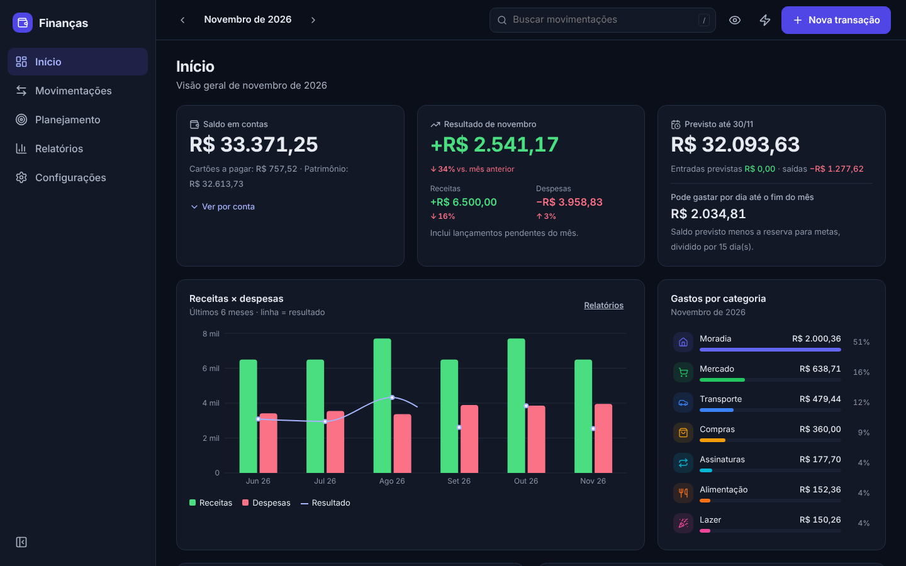
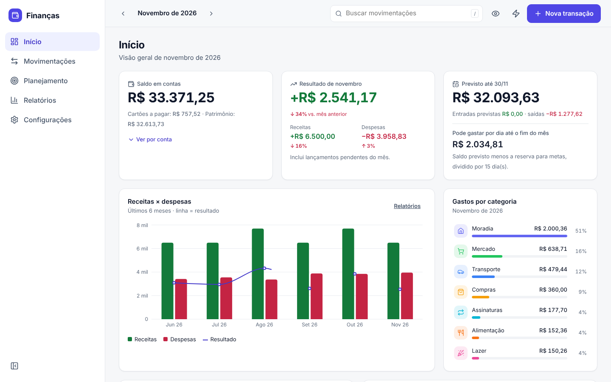
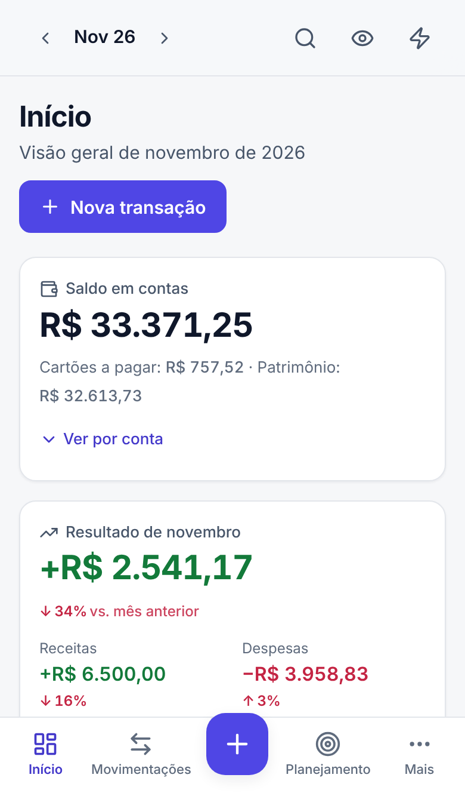

<h1 align="center">💰 Finanças</h1>

<p align="center">
  Controle financeiro pessoal <b>local-first</b>: receitas, despesas, contas, cartões, parcelas, recorrências, orçamentos, metas, relatórios e projeções — no seu navegador, sem servidor.
</p>

<div align="center">

  [](https://financas.gcruz.dev.br)
  [](https://github.com/https-shini/financas-reactjs)
  [](./LICENSE)

</div>

<div align="center">
  
</div>

---

## O que é

O **Finanças** é uma aplicação React para gestão financeira pessoal. Tudo é calculado a partir dos seus lançamentos, com regras explícitas e testadas: valores em centavos inteiros, transferências que não alteram o patrimônio, pendentes fora do saldo realizado, pagamento de fatura sem duplicar despesas e recorrências que nunca geram duplicados.

Os dados ficam **somente no seu navegador** (localStorage) e funcionam offline. Use o **backup em JSON** para guardar uma cópia ou levar seus dados para outro dispositivo.

## Funcionalidades

**Início (dashboard)** — saldo em contas (com detalhe por conta e dívida de cartões), resultado do mês com comparação ao mês anterior, saldo previsto até o fim do mês, "quanto posso gastar por dia", receitas × despesas dos últimos 6 meses, gastos por categoria, próximos vencimentos, últimas movimentações, orçamentos e insights.

**Movimentações** — cadastro, edição, duplicação e exclusão com desfazer; busca; filtros por período, tipo, status, categoria e conta (refletidos na URL); ordenação; agrupamento por dia; totais do filtro; seleção em lote (marcar como pago, recategorizar, excluir); exportação do filtro em CSV, Excel, PDF e Word.

**Cadastro** — painel (bottom sheet no celular) com valor primeiro e máscara `R$ 1.234,56`, tipo, descrição, categorias em grade, data com atalhos Hoje/Ontem, conta, status pago/pendente, observações, **repetir** (recorrência) e **parcelar**. Enter salva, Esc fecha, "Salvar e criar outra". Edição de lançamento recorrente (só este / toda a série) e de parcela (só esta / todas).

**Planejamento**
- Vencimentos: contas a pagar e a receber, atrasados, faturas, marcar como pago/recebido.
- Orçamentos: limite mensal por categoria, ajuste para um mês específico, alertas em 80% e 100%, histórico de 6 meses.
- Metas: valor, prazo, aportes e resgates, progresso e aporte mensal sugerido.
- Recorrências: diária, semanal, mensal e anual com intervalo e data final; edição da série; encerramento; **detecção de assinaturas** (sugestões confirmadas pelo usuário).
- Cartões: limite, fechamento, vencimento, faturas, compras parceladas, pagamento total/parcial ou agendado.
- Simulador: corte de gastos por categoria, aumento de receita, aportes e antecipação de parcelas — impacto em 6 e 12 meses, sem alterar dados reais.

**Relatórios** — mensal, anual (com evolução do patrimônio), comparação entre períodos, projeção de saldo em 30/90 dias com alerta de saldo negativo e **saúde financeira** (0–100 com critérios transparentes). Exportação em PDF e CSV.

**Configurações** — tema claro/escuro/automático, ocultar valores, formato regional e moeda, categorias (criar, editar, ícone, cor, palavras-chave, arquivar, excluir movendo os lançamentos), contas, **importação** (CSV, XLSX e OFX com mapeamento de colunas, prévia, linhas inválidas e possíveis duplicados), exportação completa, **backup e restauração** com prévia e cópias de segurança automáticas.

**Captura rápida** — tecla `Q` ou ícone ⚡: escreva "Mercado 85,90 ontem" e confirme a prévia.

**Atalhos** — `N` nova transação · `Q` captura rápida · `/` buscar · `←` `→` trocar mês · `Esc` fechar.

## Capturas

| Tema claro | Celular | Cadastro no celular |
| --- | --- | --- |
|  |  |  |

| Movimentações | Cartões e faturas | Saúde financeira |
| --- | --- | --- |
|  |  |  |

## Como executar

Requisitos: **Node.js 18+** (recomendado 22) e npm.

```bash
git clone https://github.com/https-shini/financas-reactjs.git
cd financas-reactjs
npm install
npm run dev        # http://localhost:3000
```

| Comando | O que faz |
| --- | --- |
| `npm run dev` | Servidor de desenvolvimento (Vite) |
| `npm run build` | Build de produção em `build/` |
| `npm run preview` | Serve o build localmente |
| `npm test` | Testes automatizados (Vitest + Testing Library) |
| `npm run lint` | ESLint |

> O projeto usa `legacy-peer-deps` (arquivo `.npmrc`) por causa das dependências opcionais do Vitest 4 com o npm 10.

## Tecnologias

React 18 · Vite · React Router · Styled Components · Context API + operações puras · Recharts · Lucide · Framer Motion · date-fns · Zod · Vitest · Testing Library · SheetJS (CDN oficial, versão corrigida), jsPDF e docx carregados sob demanda.

## Seus dados

- Armazenados apenas neste navegador; nenhum dado é enviado a servidores.
- Dados da versão anterior são **migrados automaticamente** com cópia de segurança prévia (a chave antiga é preservada).
- Dados corrompidos abrem uma **tela de recuperação** — nada é apagado sem sua escolha.
- Faça backups regulares em **Configurações › Dados**.

Documentação técnica: [modelo de dados, regras e backup](./read-model/MODEL.md) · [estrutura e decisões](./read-model/STRUCTURE.md) · [como contribuir](./read-model/CONTRIBUTING.md).

## Licença

MIT — veja [LICENSE](./LICENSE).


