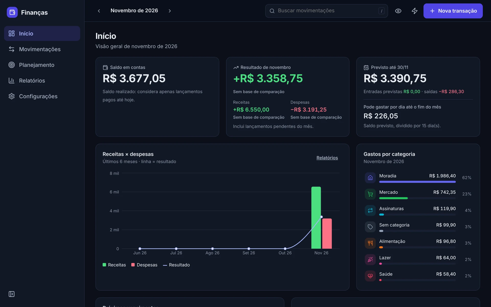
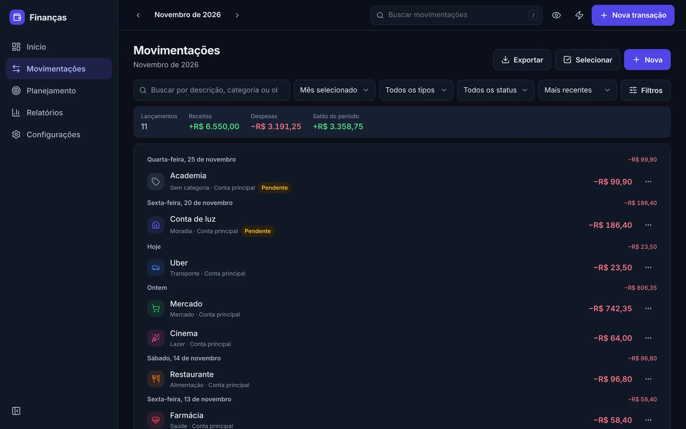
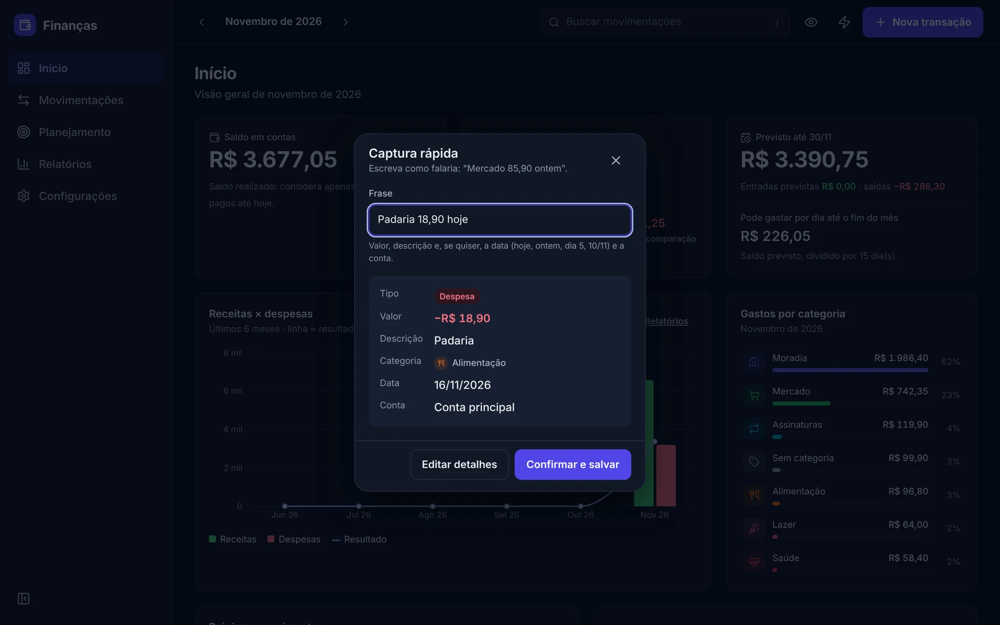
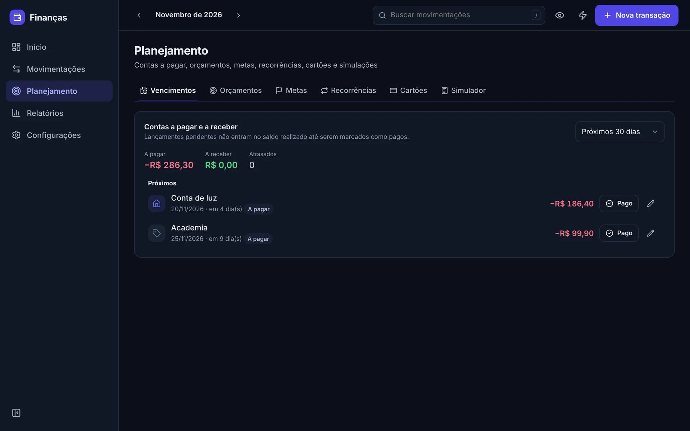
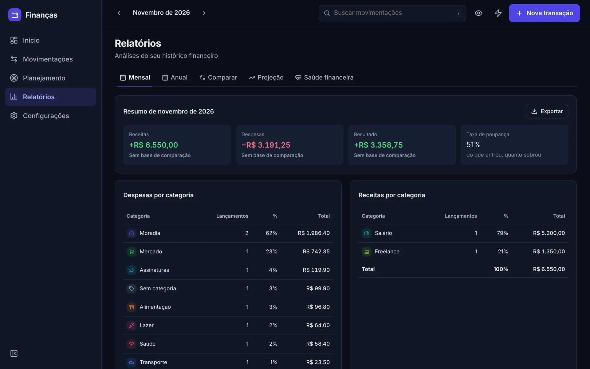
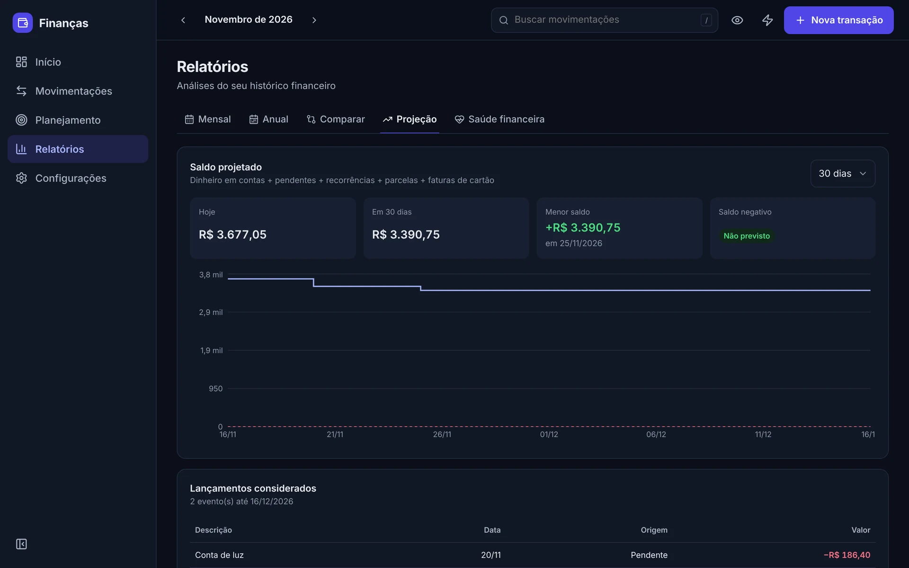
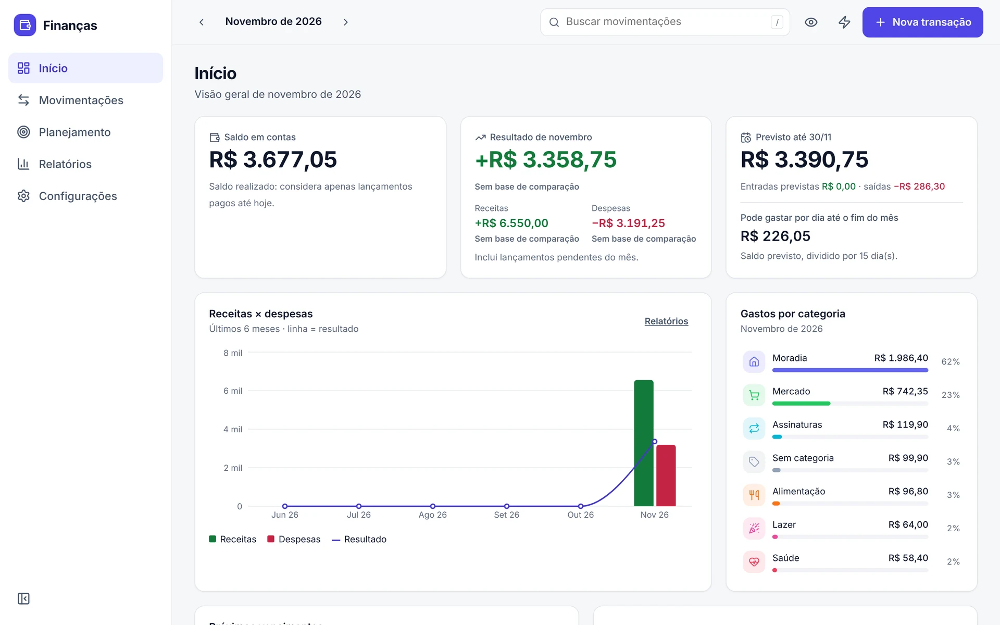
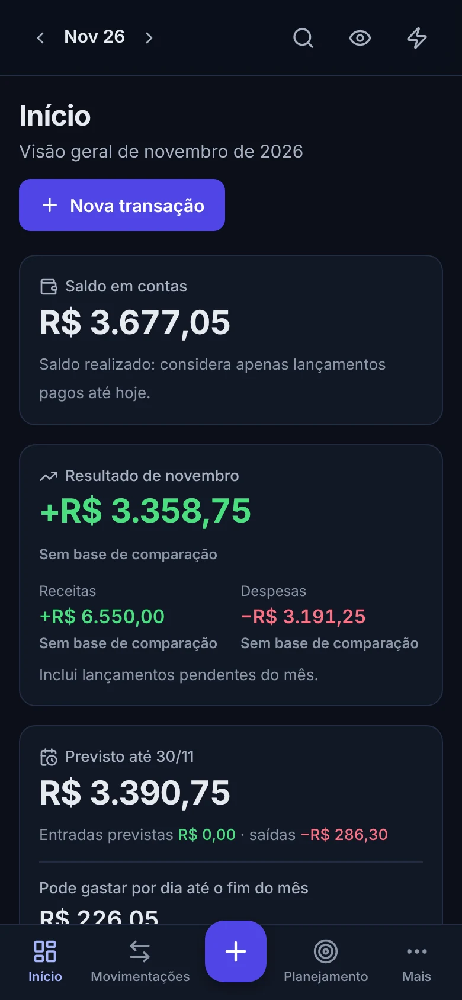

<h1 align="center">Finanças</h1>

<p align="center">
  Controle financeiro pessoal <strong>local-first</strong>: receitas, despesas, contas, cartões, parcelas, recorrências,<br>
  orçamentos, metas, relatórios e projeções — tudo no navegador, sem servidor e sem cadastro.
</p>

<div align="center">

[](https://financas.gcruz.dev.br)
[](https://github.com/https-shini/financas-reactjs/actions/workflows/ci.yml)
[](LICENSE)

</div>



<p align="center">
  <a href="https://financas.gcruz.dev.br"><strong>Acessar a aplicação</strong></a> ·
  <a href="read-model/MODEL.md">Modelo de dados e regras</a> ·
  <a href="read-model/STRUCTURE.md">Estrutura e decisões</a>
</p>

---

## Sumário

- [Sobre o projeto](#sobre-o-projeto)
- [Problema e proposta](#problema-e-proposta)
- [Funcionalidades](#funcionalidades)
- [Capturas de tela](#capturas-de-tela)
- [Tecnologias](#tecnologias)
- [Arquitetura](#arquitetura)
- [Pré-requisitos](#pré-requisitos)
- [Instalação e execução](#instalação-e-execução)
- [Variáveis de ambiente](#variáveis-de-ambiente)
- [Testes e qualidade](#testes-e-qualidade)
- [Build e deploy](#build-e-deploy)
- [Exemplos de uso](#exemplos-de-uso)
- [Seus dados: backup e segurança](#seus-dados-backup-e-segurança)
- [Limitações conhecidas](#limitações-conhecidas)
- [Licença](#licença)

## Sobre o projeto

O Finanças é uma aplicação React para gestão financeira pessoal em que todos os números vêm dos lançamentos do usuário, calculados por regras explícitas e testadas. Ela cobre o ciclo completo: registrar receitas e despesas, controlar contas e cartões de crédito, planejar orçamentos e metas, acompanhar vencimentos e projetar o saldo dos próximos meses.

Os dados ficam somente no navegador (`localStorage`), validados por schema e protegidos por migrações versionadas, cópias de segurança automáticas e uma tela de recuperação para armazenamento corrompido. Nada é enviado a servidores.

## Problema e proposta

Planilhas e aplicativos financeiros costumam errar em detalhes que distorcem o saldo: arredondamento de ponto flutuante, transferências contadas como gasto, fatura do cartão somada duas vezes, recorrências duplicadas. O Finanças trata cada um desses casos com uma regra de domínio:

- valores guardados em **centavos inteiros**;
- **transferências** movem dinheiro entre contas sem contar como receita ou despesa;
- lançamentos **pendentes** e futuros ficam fora do saldo realizado, mas entram nas projeções;
- o **pagamento de fatura** não duplica as compras já registradas no cartão;
- **recorrências** nunca geram lançamentos duplicados, mesmo abrindo o app várias vezes.

## Funcionalidades

- **Painel inicial** — saldo em contas, resultado do mês comparado ao anterior, saldo previsto até o fim do mês, quanto pode gastar por dia, receitas × despesas dos últimos 6 meses, gastos por categoria, próximos vencimentos e insights.
- **Movimentações** — cadastro, edição, duplicação e exclusão com desfazer; busca, filtros refletidos na URL, agrupamento por dia, seleção em lote e exportação do filtro em CSV, Excel, PDF e Word.
- **Planejamento** — vencimentos a pagar e receber, orçamentos por categoria com alertas em 80% e 100%, metas com aportes, recorrências com detecção de assinaturas, cartões com faturas e um simulador de cenários.
- **Relatórios** — mensal, anual com evolução do patrimônio, comparação entre períodos, projeção de 30/90 dias com alerta de saldo negativo e indicador de saúde financeira (0–100) com critérios explicados.
- **Captura rápida** — tecla `Q`: escreva "Mercado 85,90 ontem" e confirme a prévia com tipo, valor, categoria, data e conta já interpretados.
- **Importação e backup** — CSV, XLSX e OFX com mapeamento de colunas, prévia e detecção de duplicados; backup e restauração em JSON com prévia.
- Lançamento com máscara `R$ 1.234,56`, tipo (despesa, receita, transferência), status pago/pendente, repetição e parcelamento.
- Temas claro, escuro e automático, ocultação de valores, formato regional e moeda de exibição.
- Atalhos de teclado: `N` nova transação, `Q` captura rápida, `/` busca, `←` `→` troca de mês e `Esc` fecha diálogos.
- Acessibilidade: navegação por teclado, foco visível, tabelas alternativas para gráficos, contraste WCAG AA nos dois temas, `prefers-reduced-motion` e alvos de toque de 44 px.

## Capturas de tela

|                                            Movimentações                                            |                                        Captura rápida                                        |
| :-------------------------------------------------------------------------------------------------: | :------------------------------------------------------------------------------------------: |
|  |    |
|                                           **Vencimentos**                                           |                                     **Relatório mensal**                                     |
|                  |  |
|                                        **Projeção de saldo**                                        |                                        **Tema claro**                                        |
|                                        |                               |

<p align="center">
  
</p>

> Capturas da demonstração publicada, com lançamentos de exemplo inseridos pela própria interface (onboarding e captura rápida).

## Tecnologias

- **React 18** — interface com componentes funcionais, contextos e páginas carregadas sob demanda.
- **React Router 7** — navegação e filtros refletidos na URL.
- **Styled Components** — design system com tokens e temas.
- **Recharts** — gráficos de barras, área e categorias.
- **Zod** — schema e validação do armazenamento.
- **date-fns** — cálculo de datas, recorrências e vencimentos.
- **SheetJS (xlsx 0.20.3)** — importação e exportação de planilhas, a partir da CDN oficial.
- **jsPDF** — relatórios em PDF, com `jspdf-autotable`.
- **docx** — exportação para Word, com `file-saver`.
- **Lucide** — ícones.
- **React Toastify** — notificações.
- **Inter** — fonte auto-hospedada via `@fontsource-variable/inter`.
- **Vite 7** — desenvolvimento e build.
- **Vitest 4** — testes, com **Testing Library** e jsdom.
- **ESLint 9** — análise estática.
- **Vercel** — hospedagem, com cabeçalhos de segurança em `vercel.json`.

## Arquitetura

As regras de negócio são funções puras em `src/domain`, sem dependência de React. O estado é manipulado por operações puras (`store → store`) e persistido por um repositório que valida o schema, aplica migrações e guarda cópias de segurança antes de operações destrutivas.

```text
features/ (páginas e diálogos) ──► state/FinanceProvider ──► state/operations (store → store)
          │                                │                         │
          ▼                                ▼                         ▼
components/ui (design system)      storage/repository ──►   domain/ (dinheiro, datas, saldos,
                                   schema Zod, migrações,    cartões, parcelas, recorrências,
                                   backup, localStorage      orçamentos, metas, projeção, insights)
```

<details>
<summary><strong>Estrutura de diretórios</strong></summary>

```text
src/
├── domain/      regras de negócio puras e testadas
├── storage/     schema Zod, migrações, repositório (localStorage) e backup
├── state/       FinanceProvider e operações puras
├── components/  design system (ui/) e layout
├── app/         shell (menu lateral, barra superior, navegação inferior), tema e contexto de UI
├── features/    dashboard, transactions, planning, reports, settings, data, recovery
├── hooks/       formatação, media queries e atalhos de teclado
├── styles/      tokens de tema e estilos globais
└── utils/       exportação (CSV com proteção, Excel, PDF, Word e relatórios)
```

</details>

## Pré-requisitos

- **Node.js 20.19+ ou 22.12+** (exigência do Vite 7; recomendado 22 LTS) e **npm 10+**.
- Acesso a `cdn.sheetjs.com` durante a instalação: o pacote `xlsx` vem da distribuição oficial da SheetJS, fixado no `package-lock.json` com hash de integridade.

## Instalação e execução

```bash
git clone https://github.com/https-shini/financas-reactjs.git
```

```bash
cd financas-reactjs
```

```bash
npm install
```

```bash
npm run dev
```

A aplicação abre em http://localhost:3000. O arquivo `.npmrc` ativa `legacy-peer-deps`, necessário para o npm 10 resolver as dependências opcionais do Vitest 4; ele não afeta o código entregue ao navegador.

| Comando              | O que faz                                                       |
| -------------------- | --------------------------------------------------------------- |
| `npm run dev`        | Servidor de desenvolvimento                                     |
| `npm test`           | Executa todos os testes uma vez                                 |
| `npm run test:watch` | Testes em modo de observação                                    |
| `npm run lint`       | ESLint                                                          |
| `npm run build`      | Build de produção em `build/`                                   |
| `npm run preview`    | Serve o build com os mesmos cabeçalhos de segurança da produção |

## Variáveis de ambiente

Nenhuma. A aplicação não usa backend, chaves de API nem variáveis de ambiente — toda a configuração do usuário fica em **Configurações** e no armazenamento do navegador.

## Testes e qualidade

```bash
npm test
```

Os testes ficam ao lado do código (`*.test.js` e `*.test.jsx`) e cobrem dinheiro e arredondamento, datas, saldos e transferências, cartões e faturas, parcelas, recorrências, orçamentos, metas, projeções, insights, saúde financeira, simulador, captura rápida, importação (CSV, XLSX e OFX), proteção contra injeção de fórmulas, migração de dados antigos, armazenamento corrompido ou cheio, backup e fluxos da interface. Há também um teste de invariante com 2.000 operações aleatórias que confirma que nenhuma operação cria ou duplica dinheiro.

Na última verificação: **157 testes em 17 arquivos, todos aprovados**, com lint e build sem erros. A CI (`.github/workflows/ci.yml`) roda lint, testes e build a cada push e pull request; o CodeQL faz a análise de segurança.

## Build e deploy

```bash
npm run build
```

Gera `build/` com páginas carregadas sob demanda; as bibliotecas de exportação (xlsx, jsPDF, docx) só são baixadas quando usadas.

A publicação é na **Vercel**, com toda a configuração no `vercel.json` (sem depender do painel):

| Item               | Valor                                                                                                                                                                              |
| ------------------ | ---------------------------------------------------------------------------------------------------------------------------------------------------------------------------------- |
| Framework          | `vite`                                                                                                                                                                             |
| Instalação e build | `npm ci` e `npm run build`                                                                                                                                                         |
| Saída              | `build`                                                                                                                                                                            |
| Rotas              | todas reescritas para `/index.html` (SPA)                                                                                                                                          |
| Cabeçalhos         | CSP restritiva (sem `unsafe-eval` e sem domínios externos), `X-Frame-Options: DENY`, `nosniff`, `Referrer-Policy: no-referrer`, `Permissions-Policy` e cache imutável em `/assets` |
| Redirecionamento   | `financas-reactjs.vercel.app` → `financas.gcruz.dev.br`                                                                                                                            |

Para validar localmente exatamente o que será publicado, rode `npm ci`, `npm run build` e `npm run preview`.

## Exemplos de uso

**Captura rápida** (tecla `Q`):

```text
Mercado 85,90 ontem              despesa de R$ 85,90 com a data de ontem
recebi salário 5.000 dia 5       receita de R$ 5.000,00 no dia 5
Uber 23,50 hoje                  despesa em Transporte, hoje
Conta de luz 186,40 dia 20       data futura: entra como pendente
```

**Importação de planilha** — em Configurações › Dados › Importar, envie um arquivo CSV, XLSX ou OFX, associe as colunas (apenas o valor é obrigatório; data, descrição, tipo, categoria, status e observações são opcionais), revise a prévia com linhas inválidas e possíveis duplicados e confirme.

**Backup** — em Configurações › Dados › Baixar backup, o app gera um `.json` com transações, contas, cartões, categorias, orçamentos, metas, recorrências e preferências.

## Seus dados: backup e segurança

- **Onde ficam:** apenas no navegador e no dispositivo em uso; outro navegador, janela anônima ou limpeza dos dados do site não mostra os lançamentos.
- **Restauração segura:** o backup é validado e exibido em prévia antes de substituir os dados; uma cópia dos dados atuais é guardada antes.
- **Cópias automáticas:** antes de migrações, restaurações, importações e de apagar tudo (as 3 mais recentes, em Configurações › Dados).
- **Dados antigos:** os dados da versão anterior são migrados automaticamente, mantendo a chave original intacta.
- **Dados corrompidos:** abrem uma tela de recuperação; nada é apagado sem escolha do usuário.
- **Armazenamento cheio:** o app avisa que a alteração não foi salva e permite tentar de novo.
- **Exportações:** textos que poderiam ser interpretados como fórmulas (`=`, `+`, `-`, `@`) são neutralizados em CSV e XLSX.
- **Privacidade:** nada é enviado a servidores; o arquivo de backup não é criptografado.

## Limitações conhecidas

- Sem sincronização entre dispositivos e sem backup automático na nuvem.
- Sem login: qualquer pessoa com acesso ao navegador vê os dados (use "Ocultar valores" em locais públicos).
- Dados sem criptografia no armazenamento do navegador, com capacidade limitada a cerca de 5 MB.
- Não é um PWA instalável: o primeiro acesso exige conexão.
- Transferências não são importadas de planilhas/OFX; a moeda escolhida altera só a exibição, sem conversão.
- Sem integração bancária automática (Open Finance), notificações fora do app ou anexos de comprovantes.
- Os insights são calculados por regras; não há assistente com IA.

## Licença

Distribuído sob a licença MIT. Consulte o arquivo [LICENSE](LICENSE).

Desenvolvido por [Guilherme Cruz](https://gcruz.dev.br).
