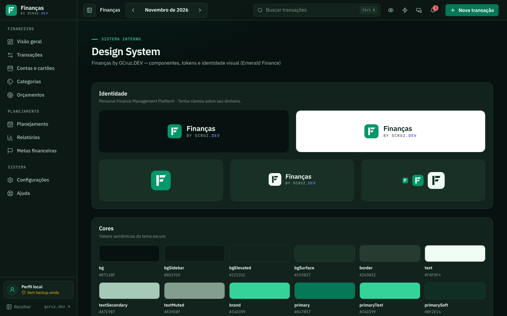
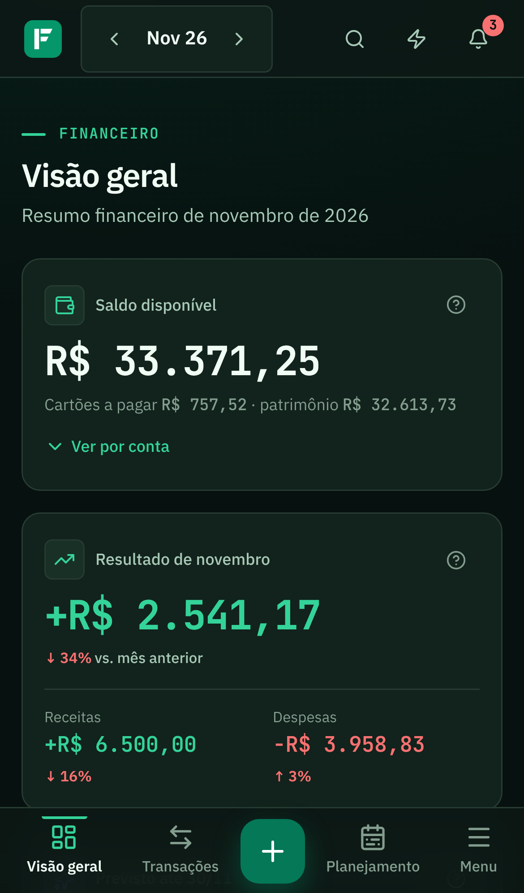
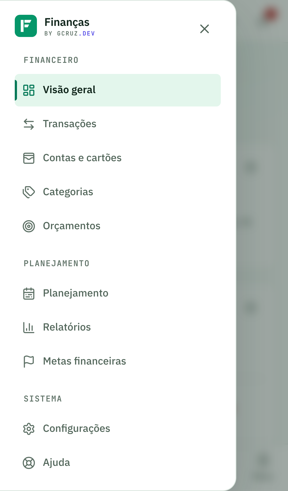
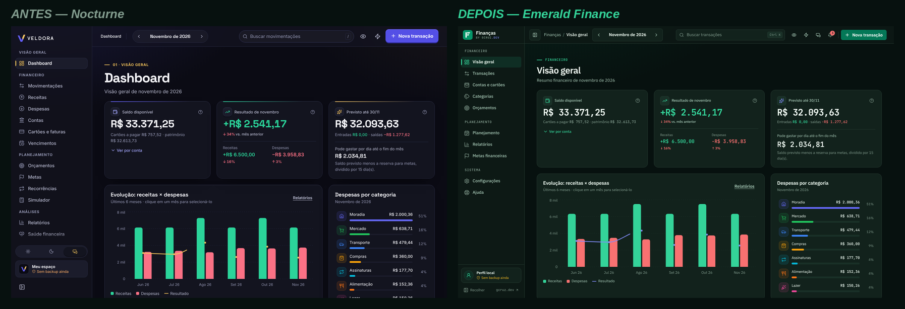
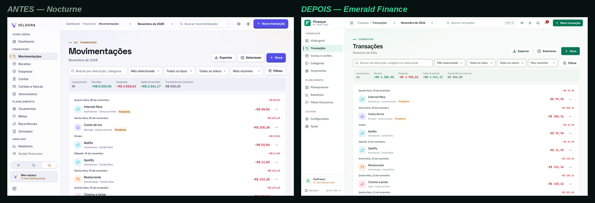
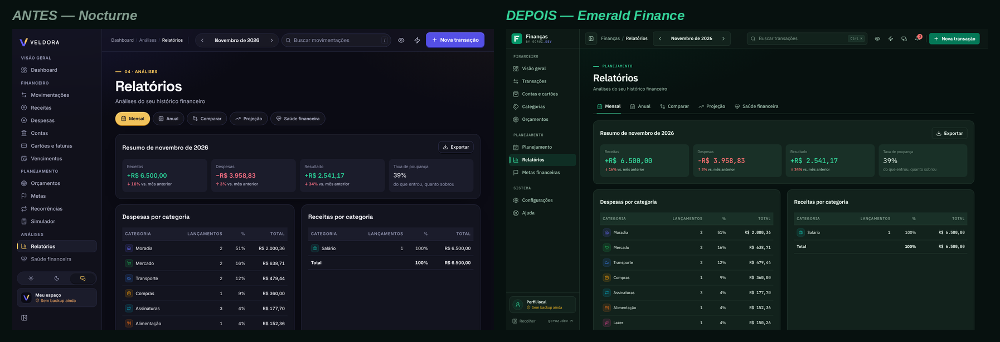
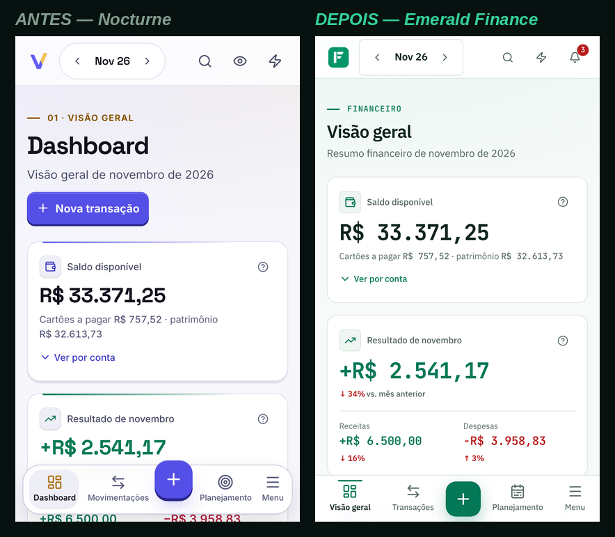

# Finanças by GCruz.DEV — Identidade visual e Design System

> **Finanças** · `BY GCRUZ.DEV`
> *Tenha clareza sobre seu dinheiro.* · Personal Finance Management Platform · paleta **Emerald Finance**

Este documento registra como a especificação **"GCruz Finanças — Brand Identity & Design System v1.0"** foi implementada no código: onde cada decisão vive, quais ajustes foram necessários e como validar.

## 1. Posicionamento e direção

- **Produto independente** do ecossistema GCruz. A marca GCruz aparece só como assinatura institucional (`BY GCRUZ.DEV`), sem competir com o nome do produto.
- **Direção:** Emerald Finance + Dark Minimalism + Functional Design. A estrutura segue o **GCruz Lab Platform** (sidebar, header e cabeçalhos de página com sobretítulo).
- **Atributos:** confiança, organização, controle, tecnologia, clareza, inteligência e simplicidade.
- **O que mudou em relação às versões anteriores (VELDORA/Nocturne):** o nome volta a ser Finanças; a paleta índigo e ouro deu lugar à Emerald; Space Grotesk e Inter deram lugar a IBM Plex Sans e JetBrains Mono; e saíram botões táteis, pílulas e sombras em cards. A interface agora é plana: as superfícies se separam por cor e borda.

## 2. Logotipo

| Elemento | Implementação |
| --- | --- |
| Símbolo | Um "F" modular: haste vertical e dois braços com as pontas inclinadas para a frente (crescimento e movimento), em branco sobre uma placa Emerald 600 com raio de 11/48. Funciona sozinho como favicon, ícone de app e avatar. |
| Lockup horizontal | Símbolo à esquerda, **Finanças** (IBM Plex Sans 600) à direita e `BY GCRUZ.DEV` abaixo (JetBrains Mono 600, caixa alta, +0,12em). O `.DEV` usa o índigo da assinatura institucional GCruz (`#818CF8` / `#4F46E5`). O coral institucional não é usado. |
| Fonte única | [`src/brand/geometry.js`](../src/brand/geometry.js): `SYMBOL_TILE`, `SYMBOL_GLYPH` e `BRAND_COLORS`. |
| Componentes | `BrandMark({ size, tone: "color" \| "mono", title })` e `BrandLockup({ size, tone: "color" \| "onDark" \| "onLight" \| "mono", compact, title })` em [`src/brand/BrandLogo.jsx`](../src/brand/BrandLogo.jsx). |
| Arquivos | `public/brand/financas-mark.svg`, `-mark-mono-dark.svg`, `-mark-mono-light.svg`, `-lockup-on-dark.svg`, `-lockup-on-light.svg`; `public/favicon.svg` e `favicon.ico` (16/32/48); `apple-touch-icon.png`; `brand/icon-192.png`, `icon-512.png` e `icon-maskable-512.png`. Os SVG vêm de `node scripts/generate-brand-assets.mjs`. |

**Regras de uso:**

- Não distorcer o símbolo nem trocar a cor da placa.
- Manter entre símbolo e texto um espaço de cerca de 1/3 da altura do símbolo.
- Usar a versão mono (recorte em `currentColor`) sobre fotos ou fundos médios.
- Não aplicar sombras ou efeitos.
- Nos SVG de lockup, o texto usa as fontes da marca com fallback do sistema. No app, o lockup é renderizado com as fontes carregadas.

## 3. Cores

Valores primitivos em [`src/design/tokens.js`](../src/design/tokens.js) (`emerald`, `pine`, `red`, `amber`, `indigo`). Valores semânticos em [`src/design/themes.js`](../src/design/themes.js).

### Escuro e claro

| Token | Escuro | Claro | Uso |
| --- | --- | --- | --- |
| `bg` | `#07110F` | `#F7FAF8` | Fundo |
| `bgSidebar` | `#0D1915` | `#FFFFFF` | Surface 1: sidebar e header |
| `bgElevated` | `#12221C` | `#FFFFFF` | Surface 2: cards |
| `bgSurface` | `#193027` | `#EFF5F1` | Surface 3: elementos elevados e áreas internas |
| `bgHover` | `#1C3229` | `#E4EEE8` | Hover |
| `border` / `borderStrong` | `#263B32` / `#56786A` | `#DCE7E0` / `#78907F` | Divisórias / contorno de campos |
| `text` / `textSecondary` / `textMuted` | `#F0FDF4` / `#A7C9B7` / `#839D8F`* | `#10251B` / `#52665A` / `#5E7166`* | Textos |
| `brand` / `primaryText` / `indicator` | `#34D399` | `#059669` / `#047857` / `#047857` | Marca, destaques, item ativo |
| `primary` → hover → active | `#047857`* → `#065F46` → `#064E3B` | igual | Botões principais (texto branco) |
| `primarySoft` | `#0F2E24` | `#E3F6EC` | Emerald Surface: item ativo, badges positivos |
| `income` (success) | `#34D399` | `#047857` | Receitas e estados positivos |
| `expense` (danger) | `#F87171` | `#B91C1C`* | Despesas, perdas e erros |
| `warning` | `#FBBF24` | `#B45309` | Alertas |
| `info` / `accent` | `#818CF8` | `#4F46E5` | Informação e visualizações complementares, como a linha de Resultado |

### Ajustes de acessibilidade em relação à especificação (*)

A especificação exige WCAG AA, e quatro valores dela não atingem esse nível. Usamos o tom compatível mais próximo, e um teste automatizado impede que eles voltem:

| Especificação | Problema | Implementado |
| --- | --- | --- |
| Primary Action escura `#059669` com texto branco | 3,77:1 | `#047857` (5,48:1), o mesmo valor do tema claro |
| Text Muted escuro `#718A7D` | 4,43:1 em cards e 3,77:1 em Surface 3 | `#839D8F` (≥ 4,81:1) |
| Text Muted claro `#75877C` | 3,6:1 a 3,8:1 | `#5E7166` (≥ 4,72:1) |
| Danger claro `#DC2626` | 4,37:1 em Surface 2 | `#B91C1C` como texto; `#DC2626` continua nas barras do gráfico (≥ 3:1) |

Também foram criados tons de borda para campos (`borderStrong`) com ≥ 3:1 contra as superfícies (WCAG 1.4.11). As bordas de divisórias continuam discretas, como pede a especificação.

[`src/design/contrast.test.js`](../src/design/contrast.test.js) verifica nos dois temas:

- texto ≥ 4,5:1 em todas as superfícies;
- botão primário em todos os estados;
- badges;
- item ativo sobre o Emerald Surface;
- foco, gráficos e contorno de campos ≥ 3:1;
- os valores exatos da especificação.

**Regras de uso:**

- Verde é para ações principais e indicadores positivos.
- Vermelho é para despesas e erros, amarelo para alertas e índigo para informação.
- Nenhum estado depende só de cor: valores têm +/−, variações têm seta, status têm rótulo e item ativo tem barra lateral e peso.

## 4. Tipografia

| Família | Uso |
| --- | --- |
| **IBM Plex Sans** (`@fontsource-variable/ibm-plex-sans`) | Interface, navegação, formulários e títulos |
| **JetBrains Mono** (`@fontsource-variable/jetbrains-mono`) | Valores monetários (`Amount`, `NumericDisplay`), percentuais, badges de status, sobretítulos, rótulos de grupo da sidebar e atalhos |

Escala (`typography.fontSize` e `roles`):

| Papel | Tamanho / peso |
| --- | --- |
| Display | 36 / 600 |
| H1 (título de página) | 30 / 600; 24 no celular |
| H2 | 24 / 600 |
| H3 | 20 / 600 |
| H4 (título de card) | 16 / 600 |
| Body | 14 / 400 |
| Small | 12 |
| Caption | 11 |

Todos os números usam algarismos tabulares. As fontes são self-hosted (CSP `font-src 'self'`), e o build nunca as embute como `data:`.

## 5. Tokens

| Grupo | Valores |
| --- | --- |
| Espaçamento | `space(n)` = n × 4 px (4, 8, 12, 16, 20, 24, 32, 40, 48, 64) |
| Raios | `xs 4 · sm 6 · md 10 · lg 14 · xl 18 · 2xl 24 · full 9999`: botões e campos em `sm`, cards em `lg`, modais em `xl` |
| Bordas | 1 px. Cards **sem sombra**; sombras só em elementos flutuantes (menus, notificações, modais, FAB) |
| Movimento | Hover 120 ms · microinterações 180 ms · dialogs e drawers 240 ms · `prefers-reduced-motion` respeitado |
| Layout | Sidebar 220 px (64 recolhida) · header 58 px · barra inferior 64 px · conteúdo até 1320 px |
| Breakpoints | 640 (tablet) · 1024 (desktop) · 1280 (largo) |

Os componentes consomem `theme.*` pelo styled-components. CSS solto usa as variáveis `--v-*` geradas por `themeToCssVars()`.

## 6. Arquitetura da interface

| Peça | Arquivo | Comportamento |
| --- | --- | --- |
| AppShell | [`src/app/AppShell.jsx`](../src/app/AppShell.jsx) | Sidebar fixa + header + conteúdo. Celular e tablet: header compacto, barra inferior e drawer. |
| Sidebar | `AppShell` + [`layout/SidebarNav.jsx`](../src/app/layout/SidebarNav.jsx) + [`layout/SidebarUser.jsx`](../src/app/layout/SidebarUser.jsx) | Branding (lockup), grupos **Financeiro** (Visão geral, Transações, Contas e cartões, Categorias, Orçamentos), **Planejamento** (Planejamento, Relatórios, Metas financeiras) e **Sistema** (Configurações, Ajuda). No rodapé: perfil local com status do backup, botão Recolher e link `gcruz.dev ↗`. Itens com 36 px (44 px em toque). Ativo: Emerald Surface + indicador lateral Emerald. |
| Header | `AppShell` | 58 px. Botão de recolher, breadcrumbs `Finanças / <página>` (≥ 1280 px), seletor de mês, busca global com `Ctrl K` (também `/`), ocultar valores, captura rápida, [`ThemeToggle`](../src/app/layout/ThemeToggle.jsx) (Escuro → Claro → Sistema, salvo em `settings.theme`), [`Notifications`](../src/app/layout/Notifications.jsx) (contas atrasadas e dos próximos 7 dias) e **Nova transação**. |
| Navegação | [`src/app/navigation.js`](../src/app/navigation.js) | `NAV_GROUPS`, `activeNavId`, `navContext` e `breadcrumbItems`. Seções sem item próprio acendem o item que as reúne: Cartões → Contas e cartões; Vencimentos, Recorrências e Simulador → Planejamento. |
| Cabeçalho de página | [`PageHeader`](../src/components/layout/Page.jsx) | Sobretítulo `— FINANCEIRO` (mono, Emerald), H1 e descrição, como no Lab Platform. |

## 7. Componentes

Todos ficam em `src/components/ui`, consomem os tokens e suportam os dois temas.

- **Ações:** `Button` (primary, secondary, ghost, danger com contorno, danger-ghost, accent em índigo; sm, md e lg; `loading`), `IconButton` e `Menu`.
- **Formulários:** `Field` (rótulo, dica e erro anunciados), `Input`, `MoneyInput`, `DatePicker`, `Select`, `Textarea`, `SegmentedControl`, `Switch`, `Checkbox`, `Radio`/`RadioGroup`. Campos com borda ≥ 3:1 e foco Emerald.
- **Componentes financeiros:**
  - `StatCard` (cards de saldo, receitas e despesas);
  - `Amount` (mono, com sinal);
  - `Delta`;
  - `Progress` (orçamentos e metas);
  - `CategoryIcon`/`CategoryChip`;
  - `DataTable` (vira lista no celular);
  - linha de transação;
  - gráficos com `useChartTheme`: receitas em Emerald, despesas em vermelho, Resultado em índigo, BRL no tooltip.
- **Navegação:** `Tabs`/`RouteTabs` (sublinhado Emerald; a aba ativa sempre fica visível), `Breadcrumbs` e `Pagination`.
- **Feedback:**
  - `Alert`;
  - toasts (react-toastify com tokens);
  - `Tooltip`;
  - `Modal`, `Drawer` e `BottomSheet` (foco preso, Esc fecha);
  - `EmptyState`, `Skeleton` e `Spinner`;
  - `Badge` (mono, raio de 4 px, como os status do Lab).
- **Ícones:** Lucide em 16, 18, 20 ou 24 px, sem emojis.

**Página de demonstração:** `/design-system`, com link em Configurações › Sobre.

## 8. Responsividade

- **Desktop (≥ 1024):** sidebar fixa, header completo, grids de 12 colunas e tabelas completas.
- **Tablet (640–1023):** header compacto, barra inferior, grids de 2 colunas e menu em drawer.
- **Celular (< 640):**
  - o menu completo abre num drawer pela barra inferior, que tem Visão geral, Transações, "+", Planejamento e Menu;
  - os cards empilham e os formulários ocupam a largura total;
  - as tabelas viram listas e os alvos de toque têm 44 px;
  - de 320 a 1023 px nada é cortado.

| Celular | Menu (drawer) |
| --- | --- |
|  |  |

## 9. Antes e depois (Nocturne → Emerald Finance)

## 10. Validação

- **Páginas:** 18 (17 do app mais `/design-system`) × 4 cenários (desktop 1440 e iPhone 13, temas claro e escuro), além das larguras 320, 360, 768 e 1024. As verificações automáticas cobrem rolagem horizontal, elementos fora da tela, texto cortado, mês truncado, aba ativa escondida, botões sobrepostos, um único H1 e console sem erros.
- **Estados:** vazios (perfil novo), erros de validação, modal "Novo cartão", folha de filtros e drawer.
- **Testes automatizados:** contraste WCAG AA, marca (símbolo, lockup, favicon, manifest), navegação da especificação, breadcrumbs, alternância e persistência de tema, `Ctrl K`, painel de notificações (teclado e Esc) e todos os testes financeiros anteriores.

## 11. Limitações conhecidas

- O app não tem contas de usuário. O "perfil" da sidebar é o **perfil local**: os dados ficam neste navegador, e o card mostra o status do backup.
- "Contas e cartões" abre Configurações › Contas. Os cartões e as faturas continuam em Planejamento › Cartões, que acende o mesmo item do menu.
- "Ajuda" abre Configurações › Sobre, com atalhos de teclado, informações e o link para o Design System.
- Os breadcrumbs do header aparecem a partir de 1280 px. Abaixo disso, o sobretítulo da página e o item ativo dão o contexto.
- Os lockups em SVG usam texto (`<text>`) com as fontes da marca e fallback do sistema. O símbolo, o favicon e os ícones são vetoriais puros.
