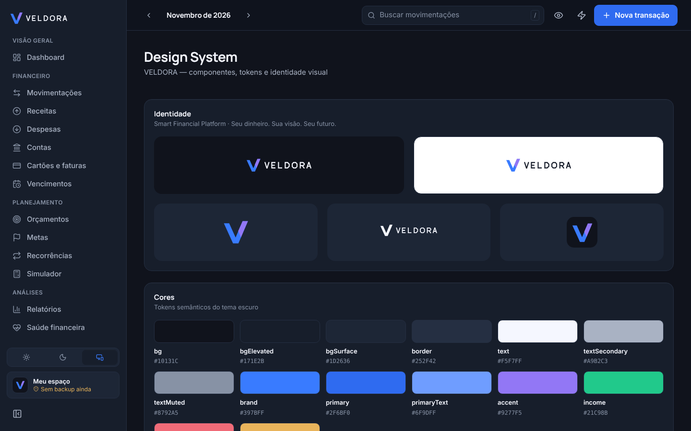
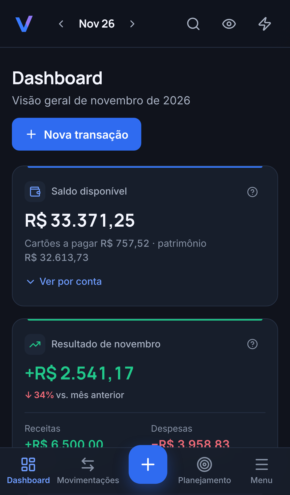
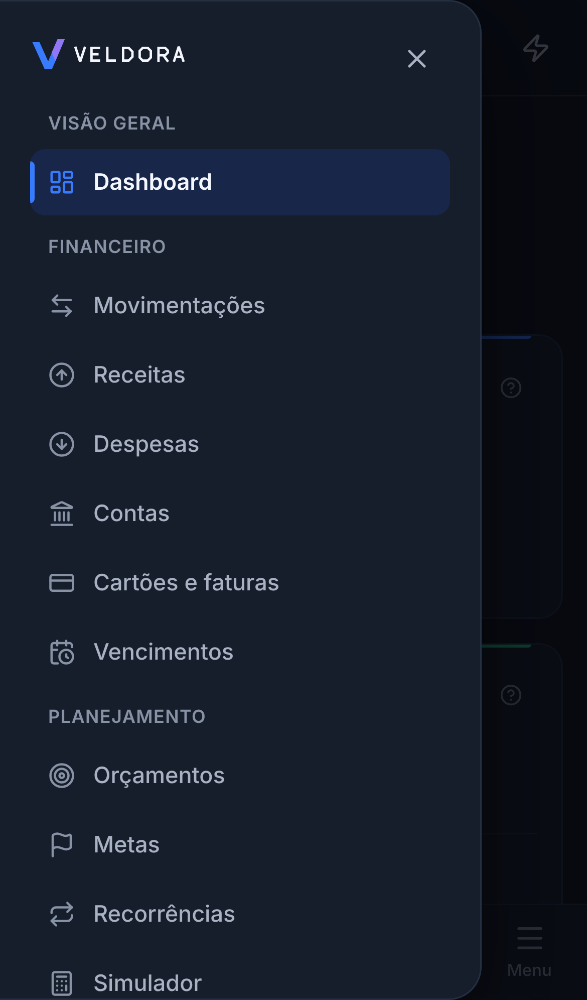
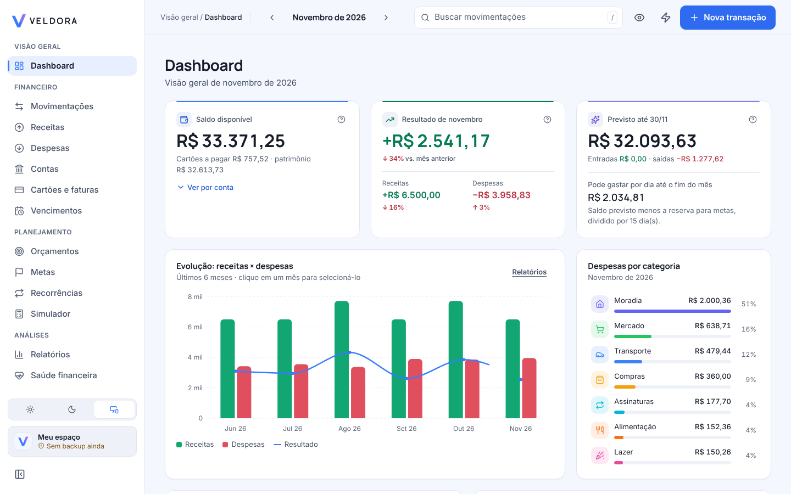

# VELDORA — Guia de marca e Design System

> **Smart Financial Platform**
> *Your money. Your vision. Your future.* · *Seu dinheiro. Sua visão. Seu futuro.*


## 1. Conceito

VELDORA é a nova identidade do antigo **Finanças**: uma plataforma financeira pessoal, local-first, que transforma lançamentos em clareza. A marca comunica **controle, precisão e progresso**, com o mesmo cuidado de ferramentas como Linear, Stripe, Revolut e Vercel, mas com linguagem própria:

- **Escuro por padrão, sem ser sombrio.** Fundos azul-noite profundos e superfícies em camadas, para que números e gráficos se destaquem.
- **Azul elétrico = ação e marca.** Violeta = inteligência (insights, previsões, recursos especiais).
- **Números são o produto.** Numerais tabulares em tudo que é valor; hierarquia clara entre rótulo, valor e variação.
- **Movimento discreto.** Transições de 150–320 ms; tudo desativado com `prefers-reduced-motion`.

### Posicionamento

| | |
| --- | --- |
| Para quem | Pessoas que querem entender e planejar o próprio dinheiro sem planilhas e sem entregar dados a terceiros. |
| O que é | Plataforma financeira inteligente que roda no navegador (dados locais, backup em arquivo). |
| Diferencial | Regras financeiras explícitas e testadas, projeções, insights e privacidade total. |
| Tom de voz | Direto, calmo, em português claro. Explica o "porquê" de cada número (dicas e tooltips). Nunca alarmista. |

## 2. Logo

O símbolo é um **V geométrico e angular**: o braço direito sobe mais alto que o esquerdo, sugerindo crescimento e direção. A faceta violeta no braço direito representa a camada de inteligência da plataforma. O wordmark **VELDORA** é desenhado em traço próprio, com cantos chanfrados nas letras V e A, sem depender de fontes externas.

A geometria fica num único arquivo, [`src/brand/geometry.js`](../src/brand/geometry.js), usado tanto pelos componentes React (`src/brand/VeldoraLogo.jsx`) quanto pelo gerador de arquivos (`node scripts/generate-brand-assets.mjs`).

| Variação | Arquivo | Uso |
| --- | --- | --- |
| Horizontal sobre escuro | `public/brand/veldora-logo-on-dark.svg` | Padrão do app (tema escuro), apresentações |
| Horizontal sobre claro | `public/brand/veldora-logo-on-light.svg` | Tema claro, documentos impressos |
| Monocromática | `public/brand/veldora-logo-mono.svg` | Um único tom (usa `currentColor`) |
| Símbolo (compacta) | `public/brand/veldora-symbol.svg` | Menu recolhido, barra superior no celular |
| Símbolo mono | `veldora-symbol-mono-dark.svg` / `-mono-light.svg` | Marca-d'água, carimbos |
| Wordmark | `public/brand/veldora-wordmark.svg` | Quando o símbolo já aparece por perto |
| Ícone do app | `public/brand/veldora-app-icon.svg`, `icon-192/512.png`, `icon-maskable-512.png`, `apple-touch-icon.png` | PWA, atalhos, tela inicial |
| Favicon | `public/favicon.svg` + `favicon.ico` (16/32/48) | Abas do navegador |

**Componentes React**

```jsx
import { VeldoraLogo, VeldoraSymbol, VeldoraAppIcon } from "src/brand/VeldoraLogo";

<VeldoraLogo height={28} />                  // cor, segue o tema
<VeldoraLogo tone="onLight" />               // forçado para fundo claro
<VeldoraLogo tone="mono" title="VELDORA" />  // herda a cor do texto
<VeldoraSymbol size={30} />                  // compacto
```

Com `title`, o SVG vira `role="img"` com nome acessível. Sem `title`, é decorativo (`aria-hidden`), para uso dentro de links que já têm rótulo.

**Regras de uso**

- Área de proteção mínima: a altura da faceta do V em todos os lados.
- Tamanho mínimo: símbolo com 16 px; logo horizontal com 80 px de largura.
- Não distorcer, girar, aplicar sombra ou contorno, trocar as cores do símbolo nem recriar o wordmark com outra fonte.
- Sobre fotos ou fundos médios, use a versão monocromática.

## 3. Cores

Paleta oficial (em `src/design/tokens.js` → `brand`):

| Token | Hex | Papel |
| --- | --- | --- |
| Electric Blue | `#397BFF` | Primária: marca, foco, indicadores, gráficos |
| Deep Black | `#10131C` | Fundo (escuro) |
| Dark Navy | `#171E2B` | Superfícies e cards (escuro) |
| Card secundário | `#1D2636` | Áreas internas (escuro) |
| Ice White | `#F5F7FF` | Texto (escuro) e fundo (claro) |
| Slate Gray | `#8792A5` | Texto secundário/mudo (escuro) |
| Violet | `#9277F5` | Destaque: inteligência, previsões |
| Emerald | `#21C98B` | Sucesso, receitas |
| Soft Red | `#F06B78` | Perigo, despesas |
| Amber | `#E9B45B` | Alerta |

Tema claro: fundo `#F5F7FF`, superfície `#FFFFFF`, cards `#EEF2F8`, texto `#151B29`.

### Acessibilidade de cor

Algumas cores oficiais não atingem WCAG AA como **texto** ou **preenchimento de botão**. Por isso existem variantes acessíveis, e a regra é: **cor oficial para marcas e indicadores, variante acessível para texto e botões.**

| Situação | Cor oficial | Variante usada | Contraste |
| --- | --- | --- | --- |
| Botão primário (branco sobre azul) | `#397BFF` (3,85:1) | `primary` `#2F6BF0` / hover `#2A63E3` / ativo `#2459D2` | ≥ 4,69:1 |
| Link azul no escuro | `#397BFF` | `primaryText` `#6F9DFF` | ≥ 4,5:1 |
| Texto mudo no claro | `#8792A5` (2,94:1) | `textMuted` `#5A6478` | ≥ 4,5:1 |
| Receita/despesa/alerta no claro | `#21C98B` / `#F06B78` / `#E9B45B` | `#067A52` / `#B8303F` / `#80530A` | ≥ 4,5:1 |

Todas essas combinações são verificadas automaticamente em [`src/design/contrast.test.js`](../src/design/contrast.test.js): texto ≥ 4,5:1 em todas as superfícies, foco e séries de gráfico ≥ 3:1. **Cor nunca é o único sinal**: valores têm sinal (+/−), variações têm seta, status têm rótulo.

## 4. Tipografia

| Papel | Fonte | Tamanho / peso | Uso |
| --- | --- | --- | --- |
| Display | Manrope | 40 / 800 | Números de destaque |
| H1 | Manrope | 28 (desktop) · 24 / 700 | Título da página |
| H2 | Manrope | 18 / 700 | Título de card |
| H3 | Inter | 15 / 600 | Subtítulo |
| Body | Inter | 15 / 400 | Texto |
| Caption | Inter | 13 / 400–500 | Rótulos, dicas |
| Overline | Inter | 12 / 600, caixa alta, `0.06em` | Grupos do menu, cabeçalhos de tabela |
| Numeric | Inter, `tabular-nums` | — | Todo valor monetário |

As fontes são self-hosted (`@fontsource-variable/inter` e `@fontsource-variable/manrope`), sem chamadas externas. Componentes: `Text`, `Heading`, `NumericDisplay`, `Overline`, `Subheading`, `FieldLabel` e o helper `typeRole(role)`.

## 5. Tokens

Arquitetura em duas camadas:

1. **Primitivos**: [`src/design/tokens.js`](../src/design/tokens.js). Paleta (escalas blue, violet, emerald, red, amber, ink), tipografia, espaçamento (`space(n)` em base de 4 px), raios (`sm 6 · md 10 · lg 16 · xl 22 · full`), bordas, opacidade (`disabled .5`, `muted .72`), movimento (`fast 150 ms · base 220 ms · slow 320 ms`), breakpoints (`640 · 1024 · 1280`), `media` (inclui `coarse`, para toque), layout (sidebar 264/76 px, topbar 64 px) e camadas (z-index).
2. **Semânticos**: [`src/design/themes.js`](../src/design/themes.js). `darkTheme` e `lightTheme` com os mesmos nomes (`bg`, `bgElevated`, `bgSurface`, `text`, `textSecondary`, `textMuted`, `brand`, `primary*`, `accent*`, `income*`, `expense*`, `warning*`, `chart.*`, `shadows.*`…).

Os componentes leem `theme.colors.*` via styled-components. Para CSS solto, os mesmos tokens são exportados como variáveis CSS (`--v-color-*`, `--v-chart-*`, `--v-radius-*`, `--v-shadow-*`, `--v-motion-*`, `--v-font-*`) por `themeToCssVars()` em `:root`.

**Não use hex direto em componentes.** Use um token semântico; se faltar algum, adicione-o nos dois temas e cubra-o no teste de contraste.

## 6. Componentes

Todos em `src/components/ui` (exportados por `index.js`). Cada um tem estados consistentes: padrão, hover, foco visível (anel azul `shadows.focus`), ativo (leve escala), desabilitado (opacidade do token), carregando, erro e sucesso, quando fazem sentido.

| Grupo | Componentes |
| --- | --- |
| Ações | `Button` (primary, secondary, ghost, danger; sm/md/lg; `loading`), `IconButton` (rótulo obrigatório), `Menu` (dropdown) |
| Formulários | `Field` (rótulo, dica e erro anunciados), `Input`, `Textarea`, `Select`, `DatePicker`, `MoneyInput`, `SegmentedControl`, `Switch`, `Checkbox`, `Radio`/`RadioGroup` |
| Exibição | `Card`/`CardHeader`, `StatCard`, `Amount`, `Badge` (neutral, primary, income, expense, warning, info, accent), `Progress`, `Delta`, `CategoryIcon` |
| Dados | `DataTable` (vira cartões no celular via `data-label`), `Pagination` |
| Navegação | `RouteTabs`/`Tabs` (indicador na cor da marca), `Breadcrumbs` (automáticos no `PageHeader`), `SidebarNav`, `ThemeSwitcher` |
| Sobreposições | `Modal`, `BottomSheet`, `Drawer` (com foco preso e Esc), `Tooltip` (mouse, foco e toque), `ConfirmProvider` |
| Feedback | `Alert`, toasts (react-toastify com tokens), `EmptyState`, `Skeleton`, `Spinner` |
| Gráficos | `useChartTheme()` e `ChartLegend` em `src/components/charts/chartTheme.jsx`: eixos, grade, tooltip em BRL e cores por tema |

**Página de demonstração:** abra **`/design-system`** (link em Configurações › Sobre). Ela mostra o logo, a paleta do tema atual, a tipografia e todos os componentes com seus estados, e não lê nem grava dados financeiros.



## 7. Layout e navegação

- **Sidebar** (desktop): logo, grupos *Visão geral · Financeiro · Planejamento · Análises · Sistema*, seletor de tema e card "Meu espaço" com o status do backup. Pode ser recolhida para 76 px, só com os ícones.
- **Topbar**: contexto (grupo / página), seletor de mês, busca, ocultar valores, captura rápida e **Nova transação**.
- **Celular**: barra inferior (Dashboard, Movimentações, botão +, Planejamento, Menu). O Menu abre um drawer com a navegação completa. Não é a versão desktop espremida: tabelas viram cartões, os cards empilham e os alvos de toque têm 44 px.
- A definição da navegação fica em [`src/app/navigation.js`](../src/app/navigation.js) (`NAV_GROUPS`, `activeNavId`, `navContext`).

| Celular | Menu |
| --- | --- |
|  |  |

## 8. Temas

Escuro (padrão da marca), claro e "sistema" (segue o sistema operacional). A escolha fica em `settings.theme`, no mesmo formato de antes. A troca anima cores de fundo e texto em 220 ms, exceto com movimento reduzido.


