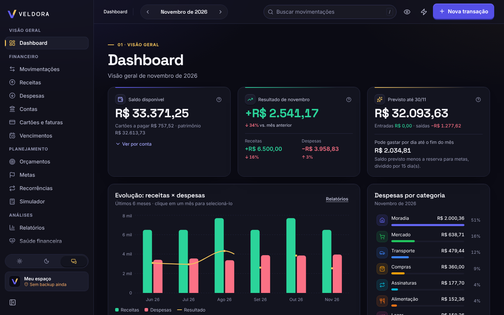
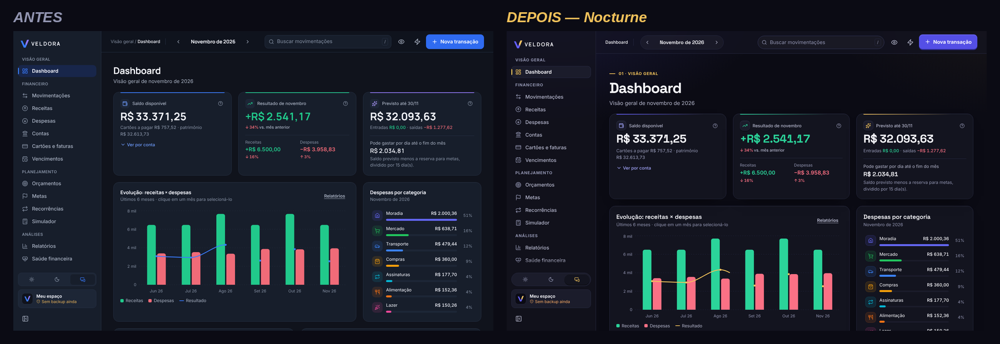
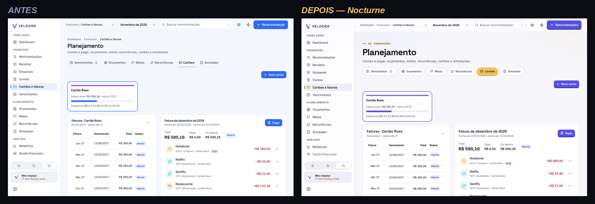
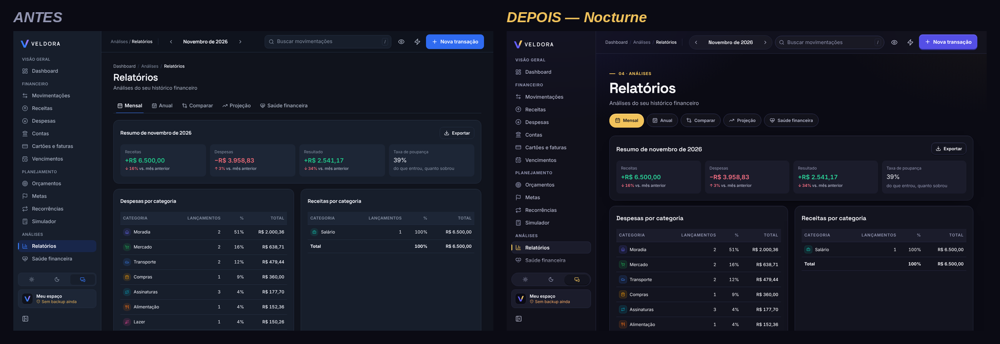
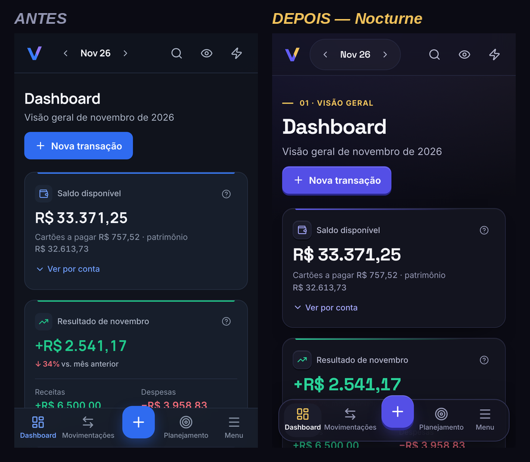

# VELDORA — Guia de marca e Design System · direção **Nocturne**

> **Smart Financial Platform**
> *Your money. Your vision. Your future.* · *Seu dinheiro. Sua visão. Seu futuro.*

## 1. Auditoria das referências

Duas referências guiaram a nova direção. Ambas foram analisadas no navegador (páginas internas, desktop e celular, temas claro e escuro, estilos computados).

### Cinelux (cinelux.gcruz.dev.br)

| Aspecto | O que encontramos |
| --- | --- |
| Paleta | Quase preto frio (`#080A0F`), superfícies translúcidas (`rgba(17,21,30,.62)`), texto `#F4F5F7`, secundário `#9BA5B5`. **Um único acento quente, ouro `#F4C95D`**, usado com parcimônia (CTA, aba ativa, sobretítulos). |
| Tipografia | **Space Grotesk** nos títulos (88/36 px, peso 700, tracking negativo de −0,045em) e DM Sans no texto. Sobretítulos em caixa alta, tracking largo, na cor do acento, com ponto ou traço e numeração ("— 01"). |
| Navegação | Topbar translúcida com sublinhado dourado no item ativo. No celular, **barra inferior flutuante em pílula**, com o item ativo destacado dentro dela. |
| Componentes | Chips e filtros em **pílula** (inativo contornado, ativo preenchido em ouro). Botões com raio de 9 px. Cards com raio de 14 px. |
| Profundidade | Anel interno de 1 px (`inset 0 0 0 1px #252D3A`) e **brilho de 1 px no topo** (`inset 0 1px 0 rgba(255,255,255,.12)`). Sombras longas e suaves. Anel de foco dourado de 4 px. |
| Temas | Somente escuro, cinematográfico, com gradientes ambientes atrás do conteúdo. |

### Fluxer (fluxer.com e app)

| Aspecto | O que encontramos |
| --- | --- |
| Paleta | **Índigo vibrante** (oklch 0,40 0,19 277 ≈ `#4641D9`). Neutros com matiz índigo, inclusive no escuro (`oklch(0.18 0.022 278)`). Ciano como acento secundário. |
| Tipografia | Radio Canada Big, muito pesada (800) e compacta. Hierarquia por peso, com títulos enormes. |
| Interação | **Botões e cards táteis**: um "degrau" sólido sob o elemento (`0 4px 0` em tom mais escuro), brilho interno no topo e afundamento ao pressionar. Ícones em **blocos sólidos índigo** com o mesmo degrau. |
| Componentes | Raios generosos (8, 12, 24 px). Pílulas (999 px) em tags e seletores. Busca com botão embutido. Seletor de tema em pílula flutuante. |
| Temas | Claro e escuro completos. O claro é branco-lavanda, e os cards claros têm um degrau cinza-lavanda na base. |
| App | Superfícies sólidas `#1A181E` e `#2A2730`, botões de 8 px, bordas `rgba(201,197,211,.15)`, mais denso e utilitário que o site. |

## 2. Conceito — **Nocturne**

> *Uma noite índigo, iluminada por ouro.*

A VELDORA combina o **clima cinematográfico** do Cinelux com a **fisicalidade tátil** do Fluxer, dentro de uma linguagem própria para dinheiro:

- **Noite com matiz índigo** (não preto neutro): fundo `#0B0B14` com brilho ambiente índigo no canto superior esquerdo e ouro no direito.
- **Índigo = ação.** Botões primários, foco, links e marca. Eles são **táteis**: degrau de 3 px na base que afunda ao clicar.
- **Ouro Aurum = destaque e inteligência.** Item ativo da navegação, aba ativa, sobretítulos, linha de *Resultado* nos gráficos, previsões e insights. É usado com parcimônia, como no Cinelux.
- **Pílulas** para tudo que é escolha: abas, filtros, seletor de mês, busca, controles segmentados, seletor de tema e barra inferior do celular.
- **Profundidade em camadas**: anel de 1 px, brilho de 1 px no topo e sombra longa no escuro; degrau lavanda nos cards claros.
- **Títulos grandes e editoriais** em Space Grotesk, com tracking negativo. Cada página abre com um **sobretítulo numerado** ("— 02 · Financeiro").

## 3. Logo

O símbolo continua sendo o **V angular** (braço direito mais alto), agora em **índigo com faceta Aurum**. O ícone do app é um bloco índigo com V branco, faceta dourada e o **degrau tátil** na base. O wordmark foi mantido: traço próprio, sem fonte externa.

A geometria fica num arquivo único, [`src/brand/geometry.js`](../src/brand/geometry.js), com `BRAND_COLORS` = indigo `#625DF5`, indigoDeep `#2B288C`, aurum `#F2C35B`, night `#0B0B14`, mist `#F6F6FB` e ink `#11121D`. Os arquivos são regenerados com `node scripts/generate-brand-assets.mjs`.

| Variação | Arquivo | Uso |
| --- | --- | --- |
| Horizontal sobre escuro / claro | `public/brand/veldora-logo-on-dark.svg` / `-on-light.svg` | App, apresentações, documentos |
| Monocromática | `public/brand/veldora-logo-mono.svg` | Um único tom |
| Símbolo | `public/brand/veldora-symbol.svg` (+ `-mono-dark`/`-mono-light`) | Menu recolhido, celular |
| Wordmark | `public/brand/veldora-wordmark.svg` | Quando o símbolo já aparece perto |
| Ícone do app / favicon | `veldora-app-icon.svg`, `favicon.svg`, `favicon.ico`, `icon-192/512.png`, `icon-maskable-512.png`, `apple-touch-icon.png` | PWA, abas, tela inicial |

Os componentes React são `VeldoraLogo` (`tone`: `color`, `onDark`, `onLight`, `mono`), `VeldoraSymbol` e `VeldoraAppIcon`. Com `title`, o SVG é uma imagem acessível; sem `title`, é decorativo.

## 4. Cores

### Primitivas (`src/design/tokens.js`)

| Escala | Tons principais |
| --- | --- |
| `indigo` | 50 `#EEEEFF` · 300 `#A5A8FF` · **500 `#625DF5` (marca)** · 600 `#544FE6` (botão) · 700 `#4B46DB` (hover) · 800 `#433FCF` (ativo) · 850 `#3F3CC4` (texto claro) · 900 `#2B288C` (degrau) · 950 `#1E1F45` |
| `aurum` | 50 `#FDF4DD` · **500 `#F2C35B` (destaque)** · 700 `#A87A08` (indicador no claro) · 800 `#7A5A00` (texto no claro) · 950 `#2A2416` |
| `emerald` | 500 `#2BD49A` · 600 `#0F9F6E` · 800 `#087A55` |
| `coral` | 500 `#FB7185` · 600 `#E5485F` · 800 `#B8243F` |
| `ember` | 500 `#FFB067` · 800 `#8F4A00` |
| `ink` (neutros índigo) | 0 `#FFFFFF` · 25 `#F6F6FB` · 50 `#EEEEF6` · 100 `#DEDFEC` · 300 `#B4B6CC` · 400 `#9396B2` · 500 `#5A5D7C` · 600 `#4A4C66` · 850 `#262840` · 880 `#1B1C2B` · 900 `#13141F` · 950 `#0B0B14` · 975 `#11121D` |

### Semânticas (`src/design/themes.js`)

| Token | Escuro | Claro | Uso |
| --- | --- | --- | --- |
| `bg` / `bgElevated` / `bgSurface` | `#0B0B14` / `#13141F` / `#1B1C2B` | `#F6F6FB` / `#FFFFFF` / `#EEEEF6` | Fundo, cards, áreas internas |
| `bgGlass` / `bgInput` | vidro 72% / branco 3,5% | branco 78% / branco | Barras flutuantes / campos |
| `text` / `textSecondary` / `textMuted` | `#F6F6FB` / `#B4B6CC` / `#9396B2` | `#11121D` / `#4A4C66` / `#5A5D7C` | Texto |
| `brand` / `primary*` / `primaryText` | `#625DF5` / `#544FE6`… / `#A5A8FF` | idem / `#3F3CC4` | Marca, botões, links |
| `accent` / `accentText` / `onAccent` | `#F2C35B` / `#F2C35B` / `#11121D` | `#F2C35B` / `#7A5A00` / `#11121D` | Destaque, sobretítulos |
| `indicator` | `#F2C35B` | `#A87A08` | Item ativo (nav, abas, ícones) |
| `income` / `expense` / `warning` | `#2BD49A` / `#FB7185` / `#FFB067` | `#087A55` / `#B8243F` / `#8F4A00` | Valores e estados |
| `chart.*` | income, expense, primary (índigo), **accent (ouro = Resultado)**, neutral, area | tons 600/700 | Gráficos |
| `ambient` | gradientes índigo + ouro | idem, mais suaves | Fundo do `body` |

### Acessibilidade

Verificada automaticamente em [`src/design/contrast.test.js`](../src/design/contrast.test.js), nos dois temas:

- todos os tokens de texto ≥ **4,5:1** sobre `bg`, `bgElevated` e `bgSurface`;
- branco sobre `primary`, `primaryHover` e `primaryActive` ≥ 4,5:1 (5,5 a 7:1);
- `onAccent` sobre ouro ≥ 4,5:1 (11:1);
- texto de badges sobre fundos suaves ≥ 4,5:1;
- foco, **indicador ativo** e séries de gráfico ≥ **3:1**.

No tema claro, o ouro "puro" (1,7:1 sobre branco) nunca é usado como texto ou indicador. Nesses casos entram `accentText` `#7A5A00` e `indicator` `#A87A08`. Cor nunca é o único sinal: valores têm +/−, variações têm seta, status têm rótulo.

## 5. Tipografia

| Papel | Fonte | Tamanho / peso / tracking |
| --- | --- | --- |
| Display | Space Grotesk | 44 / 700 / −0,035em |
| H1 (título da página) | Space Grotesk | 44 desktop · 34 celular / 700 / −0,035em |
| H2 (título de card) | Space Grotesk | 18 / 600 / −0,01em |
| H3 | Inter | 15 / 600 |
| Body | Inter | 15 / 400, altura de linha 1,55 |
| Caption | Inter | 13 |
| Overline / Eyebrow | Inter | 12 / 700, caixa alta, +0,08em (Eyebrow em Aurum, com traço) |
| Valores em destaque | Space Grotesk, `tabular-nums` | — |

As fontes são self-hosted: `@fontsource-variable/inter` e `@fontsource-variable/space-grotesk` (a Manrope foi removida). O build nunca embute fontes como `data:` (CSP `font-src 'self'`).

## 6. Espaço, raios, elevação e movimento

- **Espaçamento:** `space(n)` em base de 4 px.
- **Raios:** `xs 6 · sm 8 · md 11 · lg 18 · xl 24 · full 999`. Pílulas para escolhas, `md` para botões e campos, `lg` para cards, `xl` para modais.
- **Sombras** (`theme.shadows`):
  - `card`: brilho de 1 px no topo + base escura + sombra longa no escuro; degrau lavanda de 3 px no claro.
  - `ledge` / `ledgePressed`: degrau índigo de 3 px dos botões primários, e o estado pressionado.
  - `ledgeNeutral`: degrau dos botões secundários e da opção ativa em controles segmentados.
  - `tile`: blocos de ícone.
  - `brand`: FAB e destaques, com degrau e brilho índigo.
  - `focus`: anel de 3 px em índigo.
- **Movimento:** 90 ms para pressionar, 150 ms para hover, 220 ms para tema e 320 ms para modais. Tudo é desativado com `prefers-reduced-motion`.

## 7. Componentes

Todos consomem os mesmos tokens (`theme.*` no styled-components ou variáveis `--v-*`).

| Componente | Linguagem Nocturne |
| --- | --- |
| `Button` | `primary` tátil (degrau índigo, afunda 2 px), `secondary` com degrau neutro, `ghost`, `danger` (contorno coral que preenche no hover), **`accent`** (ouro) e `danger-ghost`. Tamanhos sm, md e lg; `loading`. |
| `IconButton`, `Menu`, `Tooltip` | Superfícies elevadas com raio `md`; o tooltip abre com mouse, foco e toque. |
| Campos (`Input`, `Select`, `DatePicker`, `MoneyInput`, `Textarea`) | Fundo `bgInput`, borda forte, foco em índigo com anel e fundo elevado. O erro usa borda coral e mensagem com ícone "!". |
| `SegmentedControl`, `ThemeSwitcher` | Trilho em pílula rebaixado; a opção ativa fica elevada, com degrau. |
| `Tabs` / `RouteTabs` | **Pílulas**: inativas contornadas, ativa preenchida em ouro, com degrau. |
| `Card`, `StatCard` | Raio 18, sombra `card`. O StatCard tem barra superior em gradiente na cor semântica e ícone em bloco. |
| `DataTable` | Cabeçalho em overline e numerais tabulares; vira cartões no celular. |
| `Badge`, `Progress`, `Delta`, `Alert`, `EmptyState` | Badges em pílula; trilho de progresso rebaixado; estado vazio com bloco de ícone índigo tátil. |
| `Modal`, `Drawer`, `BottomSheet` | Fundo desfocado (blur de 6 px), raio 24 e título em display. |
| `PageHeader` + `Eyebrow` | Sobretítulo numerado em Aurum e H1 editorial grande. A trilha (`Breadcrumbs`) fica na topbar. |
| Gráficos (`useChartTheme`, `ChartLegend`) | Receitas em esmeralda, despesas em coral, **Resultado em ouro**, patrimônio e saldo em índigo; grade pontilhada com matiz índigo e tooltip em BRL. |

**Página de demonstração:** **`/design-system`** (link em Configurações › Sobre).

## 8. Layout e navegação

- **Sidebar** de vidro: logo; grupos *Visão geral · Financeiro · Planejamento · Análises · Sistema*; item ativo em superfície elevada com **barra e ícone em ouro**; lista que esmaece na base ao rolar; seletor de tema em pílula; card "Meu espaço". Pode ser recolhida para 80 px.
- **Topbar** de vidro: trilha (breadcrumbs), seletor de mês em pílula, busca em pílula, ocultar valores, captura rápida e **Nova transação**.
- **Celular**: barra inferior **flutuante em pílula**, com item ativo destacado e FAB índigo tátil. O Menu abre um drawer com a navegação completa. Tabelas viram cartões e os alvos de toque têm 44 px.

| Celular | Menu |
| --- | --- |
|  |  |

## 9. Antes e depois

