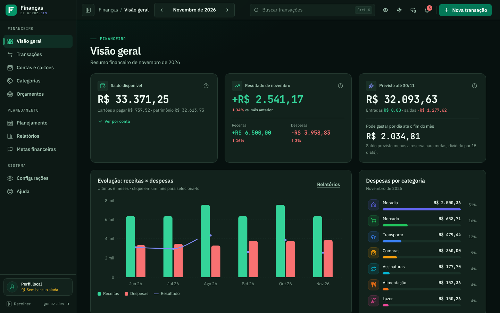
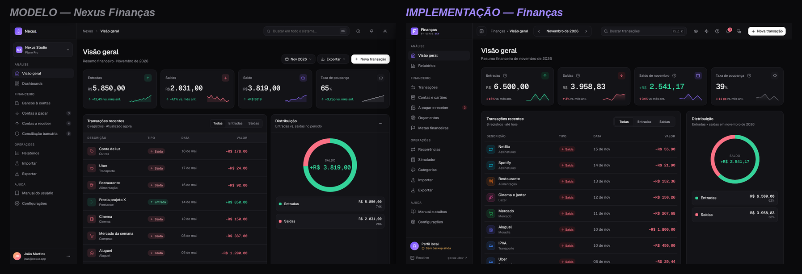
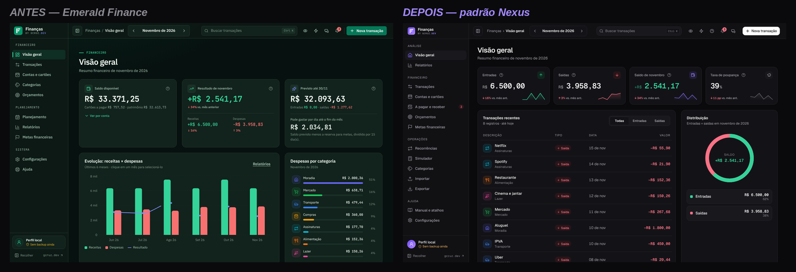
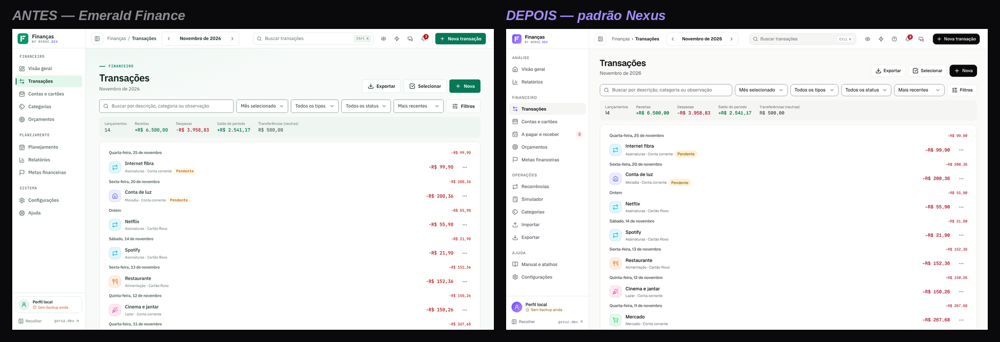
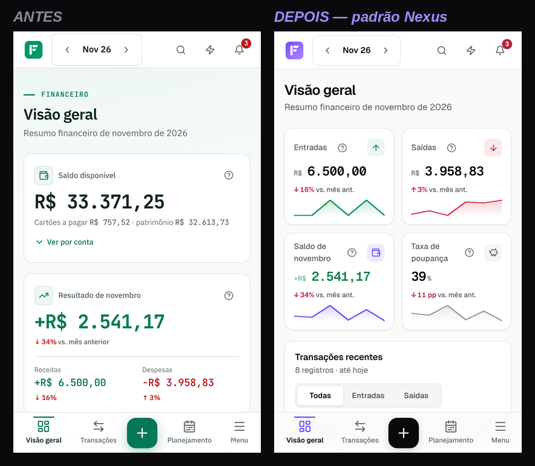

# Finanças by GCruz.DEV — Identidade visual e Design System (padrão Nexus)

> **Finanças** · `BY GCRUZ.DEV` · *Tenha clareza sobre seu dinheiro.*

A interface toma como base o modelo **Nexus Finanças**, um protótipo em HTML fornecido como referência. O modelo foi aplicado ao produto Finanças com a marca e a assinatura GCruz.DEV. Este documento registra o que foi adotado do modelo, onde cada decisão vive no código e quais ajustes foram necessários.

## 1. O que veio do modelo

| Aspecto | Modelo Nexus | Implementação |
| --- | --- | --- |
| Paleta | Neutros zinco e um único acento violeta | `palette.zinc` e `palette.violet` em [`tokens.js`](../src/design/tokens.js) |
| Botão primário | Invertido: preto no claro, branco no escuro, com brilho interno | `Button variant="primary"` (`primary` / `onPrimary`) |
| Tipografia | Geist (interface) e Geist Mono (números) | `@fontsource-variable/geist` e `geist-mono`, self-hosted |
| Sidebar | 248 px; seções em caixa alta; item ativo em superfície secundária com ícone violeta; contadores; usuário no rodapé | [`SidebarNav`](../src/app/layout/SidebarNav.jsx) e [`SidebarUser`](../src/app/layout/SidebarUser.jsx) |
| Topbar | 60 px; breadcrumbs com chevron; busca com atalho; ajuda, notificações e tema | [`AppShell`](../src/app/AppShell.jsx), [`Notifications`](../src/app/layout/Notifications.jsx) e [`ThemeToggle`](../src/app/layout/ThemeToggle.jsx) |
| Cabeçalho de página | Título de 26 px e subtítulo; ações à direita | [`PageHeader`](../src/components/layout/Page.jsx) |
| KPIs | Rótulo, ícone em bloco suave, valor em mono com "R$" menor, variação e minigráfico | `StatCard` + [`Sparkline`](../src/components/charts/Sparkline.jsx) + `Amount big`; no dashboard: Entradas, Saídas, Saldo do mês e Taxa de poupança |
| Transações recentes | Tabela Descrição · Tipo · Data · Valor, badge de tipo e filtro Todas / Entradas / Saídas | `RecentCard` no dashboard (clique edita a transação) |
| Distribuição | Donut entradas × saídas com o saldo no centro e legenda em linhas | `DistributionCard` no dashboard |
| Controles | Abas segmentadas, chips em pílula, campos de 36 px, raios de 6, 10, 14 e 20 px | `Tabs`/`RouteTabs`, `SegmentedControl`, `Badge` e `controlStyles` |
| Logotipo | Placa com gradiente violeta | Símbolo "F" do Finanças sobre a mesma placa em gradiente (`#6D4CFF` → `#B388FF`) |

**Mantido do Finanças:**

- nome e assinatura (`BY GCRUZ.DEV`);
- todas as páginas e funcionalidades (cartões e faturas, orçamentos, metas, recorrências, simulador, relatórios, importação, exportação e backup);
- seletor de mês global, captura rápida, ocultar valores, notificações de vencimentos e atalhos.

**Não adotado:**

- elementos do modelo sem funcionalidade correspondente no app: "Conciliação bancária", "Dashboards" e o seletor de organização "Nexus Studio · Plano Pro";
- usuário com e-mail: o app não tem contas de usuário, então o rodapé mostra o perfil local com o status do backup.

## 2. Navegação

| Seção | Itens (rota) |
| --- | --- |
| **Análise** | Visão geral (`/`), Relatórios (`/relatorios/*`) |
| **Financeiro** | Transações, Contas e cartões (inclui Cartões e faturas), A pagar e receber (com contador de atrasadas e dos próximos 7 dias), Orçamentos, Metas financeiras |
| **Operações** | Recorrências, Simulador, Categorias, Importar (`/configuracoes/dados#importar`), Exportar (`#exportar`) |
| **Ajuda** | Manual e atalhos (`/configuracoes/sobre`), Configurações |

- A definição fica em [`src/app/navigation.js`](../src/app/navigation.js) (`NAV_GROUPS`, `activeNavId`, `navContext` e `breadcrumbItems`).
- No celular, a barra inferior tem Visão geral, Transações, "+", Planejamento e Menu, e o Menu abre um drawer com as mesmas seções.

## 3. Cores

| Token | Escuro | Claro | Uso |
| --- | --- | --- | --- |
| `bg` | `#0A0A0C` | `#FAFAF9` | Fundo |
| `bgSidebar` | `#111114` | `#FFFFFF` | Sidebar e topbar |
| `bgElevated` | `#131317` | `#FFFFFF` | Cards |
| `bgSurface` / `bgHover` | `#18181D` / `#1F1F25` | `#F5F5F4` / `#F0F0EE` | Áreas internas, item ativo, hover |
| `border` / `borderStrong` | `#25252B` / `#66666F`* | `#E7E7E4` / `#8A8A92`* | Divisórias / contorno de campos |
| `text` / `textSecondary` / `textMuted` | `#EDEDEE` / `#A1A1AA` / `#8B8B93`* | `#0A0A0B` / `#5B5B63` / `#6B6B73`* | Textos |
| `primary` → `onPrimary` | `#FFFFFF` → `#0A0A0B` | `#0A0A0B` → `#FAFAFA` | Botão primário invertido |
| `brand` / `accentText` / `indicator` | `#8B6BFF` / `#A48BFF` / `#8B6BFF` | `#6D4CFF` / `#5B3DF0` / `#6D4CFF` | Acento violeta: foco, ícone ativo, links |
| `income` | `#34D39A` | `#0A7F48`* | Entradas |
| `expense` | `#FB7185` | `#B3263A` | Saídas |
| `warning` | `#F5B65B` | `#8A5E0E`* | Alertas |
| `info` | `#60A5FA` | `#1A62BD`* | Informação |

### Ajustes de acessibilidade (*)

Alguns tons do modelo não atingem WCAG AA como texto. Nesses casos usamos o tom "strong" do próprio modelo ou o tom compatível mais próximo:

| Modelo | Problema | Implementado |
| --- | --- | --- |
| Texto `faint` `#9999A1` (claro) / `#6E6E76` (escuro) | 2,6–3,9:1 | `textMuted` `#6B6B73` / `#8B8B93`. Os originais ficam só em elementos decorativos (linha neutra de minigráfico). |
| Verde `#0F9D58`, âmbar `#B07B1A` e azul `#1F76E0` como texto no claro | 3,4–4,4:1 | `#0A7F48`, `#8A5E0E` e `#1A62BD`. Os tons originais continuam nas barras dos gráficos (≥ 3:1). |
| Borda de campos `#D4D4D0` / `#33333B` | 1,5:1 | `borderStrong` `#8A8A92` / `#66666F` (≥ 3:1, WCAG 1.4.11) |

[`src/design/contrast.test.js`](../src/design/contrast.test.js) verifica nos dois temas:

- texto ≥ 4,5:1 em todas as superfícies;
- botão primário em todos os estados;
- badges;
- foco, gráficos e contorno de campos ≥ 3:1;
- os valores exatos do modelo.

Nenhum estado depende só de cor: valores têm +/−, variações têm seta, tipos têm rótulo e ícone ("↓ Saída"), e o item ativo tem fundo e peso.

## 4. Tipografia

| Papel | Fonte | Tamanho / peso |
| --- | --- | --- |
| Título de página | Geist | 26 px (22 no celular) / 600 / −0,02em |
| Título de card | Geist | 14 / 600 |
| Corpo | Geist | 14 / 400 |
| Rótulos e legendas | Geist | 12–13 / 500 |
| Seções da sidebar e cabeçalhos de tabela | Geist | 11 / 500, caixa alta, +0,08em |
| Valores | **Geist Mono** | KPI 28 (20 no celular) / 600; tabelas 14; "R$" a 54% do tamanho |

As fontes são self-hosted (CSP `font-src 'self'`), e o build nunca as embute como `data:`.

## 5. Tokens

| Grupo | Valores |
| --- | --- |
| Raios | `xs 4 · sm 6 · md 10 · lg 14 · xl 20 · full` |
| Sombras | `card` discreta no claro (0 1px 2px); `md` e `lg` só em elementos flutuantes; anel de foco violeta de 3 px |
| Movimento | 120 ms (hover) · 220 ms (tema) · 260 ms (dialogs); `prefers-reduced-motion` respeitado |
| Layout | Sidebar 248 px (64 recolhida) · topbar 60 px · barra inferior 64 px · conteúdo até 1320 px |

## 6. Marca

- **Símbolo:** "F" modular (haste e dois braços inclinados) sobre uma placa em gradiente violeta. Serve de favicon, ícone de app e avatar.
- **Lockup:** "Finanças" com `BY GCRUZ.DEV` em Geist Mono, e o `.DEV` no índigo da assinatura GCruz.
- **Componentes:** `BrandMark` e `BrandLockup` em [`src/brand/BrandLogo.jsx`](../src/brand/BrandLogo.jsx).
- **Geometria:** em [`src/brand/geometry.js`](../src/brand/geometry.js).
- **Arquivos:** `public/brand/financas-*.svg`, `favicon.svg`/`.ico` e os ícones PWA, gerados por `node scripts/generate-brand-assets.mjs`.

## 7. Responsividade

- **Desktop (≥ 1024 px):** sidebar fixa e topbar completa. Os breadcrumbs e o rótulo "Nova transação" aparecem a partir de 1280 px; entre 1024 e 1279 px o botão vira ícone.
- **Tablet e celular:** topbar compacta, barra inferior e menu em drawer.
- **KPIs:** 2 colunas no celular, com a variação e o minigráfico empilhados.
- **Tabela de transações recentes:** no celular mostra só descrição e valor.
- **Larguras:** de 320 a 1023 px nada é cortado.

| Celular | Menu |
| --- | --- |
|  |  |

## 8. Antes e depois (Emerald Finance → padrão Nexus)

## 9. Estrutura (Sidebar, Header e estados)

Refeita do zero com base no **GCruz Lab Platform**, preservando a identidade do Finanças.

**Sidebar (248 px; 64 px recolhida)**

- **Faixa da marca:** altura igual à do header (64 px), com a borda inferior contínua. Mostra o símbolo e "Finanças" com a assinatura `by <gcruz.dev/>`.
- **Seções:** rótulos em caixa alta espaçada (Análise · Financeiro · Operações · Ajuda), com 20 px entre elas.
- **Itens:** 40 px de altura e ícone de 18 px.
- **Item ativo:** superfície própria, texto forte, ícone violeta e barra indicadora encostada na borda esquerda.
- **Contador:** em pílula mono ("A pagar e receber").
- **Rodapé:** cartão de perfil com borda (avatar "PL", "Perfil local", status do backup e ação de backup e dados) e a linha "Recolher" · `gcruz.dev ↗`.

**Header (64 px)**

- **Esquerda:** botão de layout com borda, que recolhe a sidebar no desktop e abre o menu no celular, seguido dos breadcrumbs `Finanças / página`.
- **Direita:** mês de referência em pílula · busca (`Ctrl K`) │ ocultar valores · tema · notificações.
- **Ações de página:** "Nova transação" e "Captura rápida" ficam no cabeçalho da Visão geral; "Nova" fica em Transações; no celular há o "+".

**Cabeçalho de página:** sobretítulo `— SEÇÃO` em violeta, título de 32 px e ações à direita.

**Conteúdo:** ocupa a largura útil (até 1680 px), com recuo de 32 a 64 px conforme a tela e um brilho de fundo sutil no tema escuro.

**Tokens e componentes:**

- `theme.layout` (`--v-layout-*`);
- estados de interação: `interactiveItem` em `src/components/ui/interaction.js`;
- componentes em `src/app/layout/`: `Sidebar`, `SidebarNav`, `SidebarUser`, `Header`, `MobileNav` e `responsive`.

## 10. Validação

- **Páginas:** 18 (17 do app mais `/design-system`) × 4 cenários (desktop e iPhone 13, temas claro e escuro), além das larguras 320, 360, 768 e 1024 px. As verificações cobrem rolagem horizontal, texto cortado, aba ativa visível, botões sobrepostos, um único H1 e console sem erros.
- **Estados:** vazios, erros de validação, modais, folha de filtros e drawer.
- **Testes automatizados:** contraste, navegação das seções, contador, KPIs, filtro de transações recentes, tema, `Ctrl K`, notificações, marca e todos os testes financeiros.
- **Página de demonstração:** `/design-system`, com link em Configurações › Sobre.
